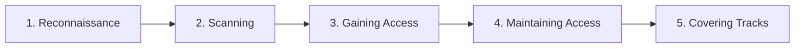
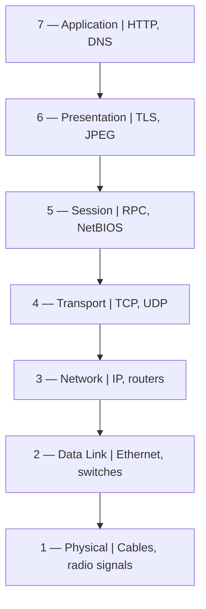

<!--
TECHBIZ | Week 1 Cybersecurity Internship Portfolio
Documentation is based on the Week 1 reports submitted by Collins Okike.
-->

<div align="center">

# 🔐 TECHBIZ Cybersecurity Internship Portfolio

### Week 1 — Cybersecurity Fundamentals, Networking Basics & Kali Linux Lab Setup

**Learning notes · Lab setup · Command-line verification · Technical documentation**

[](https://github.com/cyberlynz/TECHBIZ)
[](https://github.com/cyberlynz/TECHBIZ)
[](https://www.kali.org/)
[](https://github.com/cyberlynz/TECHBIZ)

*A practical record of the concepts studied, commands run, lab environment prepared, and lessons learned during Week 1 of my TechBiz Academy ethical hacking internship.*

</div>

---

## 📌 Project Overview

This repository documents my first week of cybersecurity training at **TechBiz Academy**. The week covered three foundations that I will continue to use as I progress through security labs:

1. **Cybersecurity and ethical hacking:** understanding what security protects, how hackers are classified, the stages of an ethical hacking engagement, and the difference between vulnerability assessment and penetration testing.
2. **Networking fundamentals:** understanding IP and MAC addresses, the OSI model, common network ports, and TCP versus UDP.
3. **Lab environment setup:** installing VirtualBox, importing Kali Linux, checking the virtual machine's network interfaces, and using basic Linux commands.

The aim is to build a reliable foundation before moving into more advanced security testing. The notes are written from my learning and practical work, with an emphasis on explaining what a concept means and why it matters to cybersecurity.

> **Portfolio note:** The command outputs and addresses below are the values recorded in my Week 1 reports. Network addresses are specific to that lab session and may differ on another machine or after a network configuration change.

## 🧭 Week 1 at a Glance

| Task | Focus | Practical output |
|---|---|---|
| **Task 1** | Cybersecurity & Ethical Hacking — Introduction | Notes on the CIA Triad, hacker types, ethical hacking phases, testing approaches, and career paths |
| **Task 2** | Networking Basics — IP, Ports, Protocols & OSI Model | Network address checks, OSI layer notes, common port reference, and TCP/UDP comparison |
| **Task 3** | Lab Setup — VirtualBox + Kali Linux | Kali Linux virtual machine running, terminal commands tested, network interfaces inspected, and packages checked |

## 🗂️ Contents

- [Task 1 — Cybersecurity and Ethical Hacking](#-task-1--cybersecurity-and-ethical-hacking)
  - [The CIA Triad](#1-the-cia-triad)
  - [White, Black, and Grey Hat Hackers](#2-white-black-and-grey-hat-hackers)
  - [Five Phases of Ethical Hacking](#3-five-phases-of-ethical-hacking)
  - [Penetration Testing vs Vulnerability Assessment](#4-penetration-testing-vs-vulnerability-assessment)
  - [Cybersecurity Career Paths](#5-cybersecurity-career-paths)
  - [Learning Resources and Takeaways](#6-learning-resources-and-takeaways)
- [Task 2 — Networking Basics](#-task-2--networking-basics)
  - [IP and MAC Addresses](#1-ip-and-mac-addresses)
  - [The Seven OSI Layers](#2-the-seven-osi-layers)
  - [Common Ports](#3-common-ports-and-services)
  - [TCP vs UDP](#4-tcp-vs-udp)
  - [Networking Practice and Takeaways](#5-networking-practice-and-takeaways)
- [Task 3 — VirtualBox and Kali Linux](#-task-3--virtualbox-and-kali-linux-lab-setup)
  - [Tools and Environment](#1-tools-and-environment)
  - [Setup Procedure](#2-setup-procedure)
  - [Commands Run](#3-commands-run-and-what-they-do)
  - [Recorded Network Results](#4-recorded-network-results)
  - [Linux Fundamentals](#5-linux-fundamentals-practice)
- [Security and Ethical Use](#-security-and-ethical-use)
- [Lessons Learned](#-lessons-learned)
- [Resources](#-resources)
- [Author](#-author)

---

# 🛡️ Task 1 — Cybersecurity and Ethical Hacking

## Objective

Understand the basic purpose of cybersecurity, the CIA Triad, different hacker types, the five phases of ethical hacking, and the distinction between vulnerability assessment and penetration testing.

## 1. The CIA Triad

The **CIA Triad** is a simple model for thinking about what security is meant to protect: confidentiality, integrity, and availability.

| Principle | Meaning | Real-world example | Security relevance |
|---|---|---|---|
| **Confidentiality** | Information is only accessible to people who are authorized to see it. | In a hospital, only staff with the appropriate access should be able to view a patient's records. | Access controls, strong authentication, and encryption help protect sensitive information. |
| **Integrity** | Information remains accurate and is not changed without authorization. | A bank transfer record must not be altered by an unauthorized person. | Hashes and digital signatures can help detect unauthorized changes. |
| **Availability** | Systems and information are accessible when authorized users need them. | Customers should be able to access an online banking service when it is needed. | Backups, resilient infrastructure, and recovery planning help maintain availability. |

### A real-world example: WannaCry

The WannaCry ransomware outbreak in 2017 disrupted computer systems around the world, including healthcare services in the United Kingdom. Some hospitals had to cancel appointments because systems and information were unavailable. This illustrates how a cyber incident can affect people and services, not just computers.

**My takeaway:** A system can have a security problem even if information has not been stolen. Unauthorized changes affect integrity, while an outage can affect availability.

## 2. White, Black, and Grey Hat Hackers

The main differences are **authorization, intention, and conduct**.

| Type | Authorization | Typical intention | Example |
|---|---|---|---|
| **White hat** | Has permission and works within an agreed scope. | Identify weaknesses and help improve security. | A penetration tester hired to test a company's website. |
| **Black hat** | Acts without authorization. | May steal information, make money illegally, disrupt services, or cause harm. | A criminal who deploys ransomware or steals payment details. |
| **Grey hat** | May find or test a weakness without permission, even if the intention is not malicious. | Often claims to expose a weakness or alert its owner. | Someone tests a website without being asked and then reports a discovered issue. |

A claimed good intention does not replace permission. Ethical testing requires authorization, an agreed scope, and responsible reporting.

## 3. Five Phases of Ethical Hacking

The five phases describe a common sequence used to explain how a security test or attack may progress.



| Phase | What it means | Example of the activity |
|---|---|---|
| **1. Reconnaissance** | Gather information about the target to understand its systems and possible exposure. | Reviewing public domain information and other permitted sources. |
| **2. Scanning** | Identify live systems, open ports, running services, and possible weaknesses. | Using Nmap or an authorized vulnerability scanner. |
| **3. Gaining Access** | Test whether a weakness can be used to access a system or application. | Validating a finding within the approved scope. |
| **4. Maintaining Access** | Assess whether access could persist after an initial compromise. | In a specifically authorized test, checking persistence risk and then removing test artifacts. |
| **5. Covering Tracks** | Understand how real attackers may attempt to conceal activity. | Defenders may look for deleted logs or other evidence of tampering. |

**Important ethical distinction:** Covering tracks describes attacker behaviour in the traditional five-phase model. During an authorized assessment, I should document my actions and preserve evidence rather than conceal my activity or delete logs.

## 4. Penetration Testing vs Vulnerability Assessment

These activities are related, but they answer different questions.

| Comparison | Vulnerability assessment | Penetration test |
|---|---|---|
| **Main goal** | Find and prioritize a broad range of weaknesses. | Test selected weaknesses to understand their real-world impact. |
| **Typical approach** | Often relies heavily on automated scanning and analysis. | Uses targeted manual testing and tools; automation may also be used. |
| **Exploitation** | Generally identifies weaknesses without attempting to exploit them. | May safely exploit weaknesses within the agreed scope. |
| **Output** | A prioritized list of findings and remediation guidance. | Evidence, validated attack paths, impact, and remediation advice. |
| **Useful question** | “What weaknesses may exist?” | “What could an attacker achieve through these weaknesses?” |

Both approaches are useful. An assessment provides visibility into possible weaknesses, while a penetration test helps validate the impact of selected findings. The testing scope and permission must be agreed before work begins.

Penetration tests may also be described as **black box** (the tester begins with little or no internal information), **grey box** (some information is supplied), or **white box** (substantial internal information is supplied).

## 5. Cybersecurity Career Paths

During this task, I explored several roles and how they contribute to security.

| Career path | Main responsibility |
|---|---|
| **Penetration Tester / Red Teamer** | Tests security with permission to identify weaknesses; red teams may simulate attacker behaviour across a broader engagement. |
| **SOC / Security Analyst** | Monitors alerts and logs, investigates suspicious activity, and escalates or reports incidents. |
| **Security Engineer** | Implements and maintains security controls, secure configurations, and protective technologies. |
| **Incident Responder** | Helps contain incidents, investigate what happened, and support recovery. |
| **Digital Forensics Examiner** | Collects and examines digital evidence from systems and logs. |
| **Malware Analyst** | Studies malicious software to understand its behaviour and how it can be detected. |
| **GRC Analyst** | Supports governance, risk management, policies, compliance activities, and audits. |

This overview helped me understand that cybersecurity includes both offensive testing and defensive work. The roles may overlap, but each has a different primary responsibility.

## 6. Learning Resources and Takeaways

I completed the following TryHackMe learning activities for this task:

- **[Pentesting Fundamentals](https://tryhackme.com/)** — introductory penetration-testing concepts.
- **[Intro to Offensive Security](https://tryhackme.com/)** — an introduction to offensive security.
- **Cybersecurity Careers** — an overview of different career paths.

The report also references beginner videos about ethical hacking and the CIA Triad.

**What I learned:** Cybersecurity is about protecting information and systems. Ethical hacking uses testing techniques with authorization to help identify weaknesses. The most important distinction is not simply which tools someone uses, but whether the work is authorized, scoped, documented, and reported responsibly.

---

# 🌐 Task 2 — Networking Basics

## Objective

Learn the networking concepts needed to understand how devices communicate and how security tools identify hosts, services, and network traffic.

## 1. IP and MAC Addresses

### What is an IP address?

An **Internet Protocol (IP) address** identifies a network interface for communication across an IP network. It helps traffic reach the intended destination.

- **IPv4** uses 32-bit addresses, commonly written as four decimal numbers separated by dots, such as `192.0.2.10`.
- **IPv6** uses 128-bit addresses, written in hexadecimal groups separated by colons, such as `2001:db8:85a3::8a2e:370:7334`.
- **Private IPv4 addresses** are used inside private networks and are not directly routed across the public internet.
- **Public IP addresses** are used for internet-facing communication, subject to the network's routing and configuration.

The three private IPv4 ranges are:

| Range | Common context |
|---|---|
| `10.0.0.0/8` | Large private networks |
| `172.16.0.0/12` | Private networks using the 172.16–172.31 range |
| `192.168.0.0/16` | Common home and small-office networks |

### What is a MAC address?

A **Media Access Control (MAC) address** identifies a network interface at the data-link layer. A typical Ethernet MAC address is 48 bits and is written as six hexadecimal pairs, for example `00:1A:2B:3C:4D:5E`.

A MAC address is useful for communication on a local network. It should not be treated as strong proof of a device's identity because addresses can sometimes be changed or spoofed.

### IP address vs MAC address

| Feature | IP address | MAC address |
|---|---|---|
| OSI association | Layer 3 — Network | Layer 2 — Data Link |
| Main purpose | Logical addressing and routing between networks | Local-network frame delivery |
| Format | IPv4 dotted decimal or IPv6 hexadecimal | Usually hexadecimal pairs |
| Can change? | Yes, depending on network configuration | Can be changed or spoofed in software on some interfaces |

A simple way to remember the difference: the IP address helps route traffic to a network destination, while the MAC address helps deliver a frame on the local network.

## 2. The Seven OSI Layers

The **Open Systems Interconnection (OSI) model** divides network communication into seven layers. It provides a structured way to discuss protocols, network behaviour, and troubleshooting.



| Layer | Name | Purpose | Example |
|---:|---|---|---|
| **7** | Application | Provides network services used by applications. | HTTP, DNS |
| **6** | Presentation | Handles data representation, encoding, compression, and encryption-related functions. | TLS-related presentation functions, JPEG |
| **5** | Session | Manages conversations or sessions between communicating systems. | RPC, NetBIOS session services |
| **4** | Transport | Supports communication between applications and uses port numbers. | TCP, UDP |
| **3** | Network | Handles logical addressing and routing. | IP, routers |
| **2** | Data Link | Moves frames across a local link using link-layer addressing. | Ethernet, switches |
| **1** | Physical | Carries raw bits as electrical, optical, or radio signals. | Cables, radio signals |

**Memory aid:** All People Seem To Need Data Processing — Application, Presentation, Session, Transport, Network, Data Link, Physical.

When data is sent, it moves down the conceptual layers at the sender and back up the layers at the receiver. Each layer contributes information needed for delivery. This process is commonly described as **encapsulation** and **decapsulation**.

### Why the OSI model matters for security

The model helps organize investigations. For example, an analyst may examine physical connectivity at Layer 1, local-network behaviour at Layer 2, IP routing at Layer 3, transport connections and ports at Layer 4, or web application activity at Layer 7. The model is a troubleshooting aid rather than a claim that every attack belongs to only one layer.

## 3. Common Ports and Services

A **port** helps a host direct network traffic to the relevant service or application. Port numbers range from 0 to 65535.

| Port | Service | Transport | Common use | Security consideration |
|---:|---|---|---|---|
| **20** | FTP data | TCP | FTP data transfer in traditional active FTP | Traditional FTP does not encrypt traffic by default. |
| **21** | FTP control | TCP | FTP commands and session control | Credentials and data may be exposed without additional protection. |
| **22** | SSH | TCP | Secure remote login and administration | Protect credentials and keys; monitor suspicious login attempts. |
| **23** | Telnet | TCP | Traditional remote terminal access | Usually unencrypted; SSH is generally preferred. |
| **25** | SMTP | TCP | Mail transfer between mail servers | Misconfiguration can contribute to spam or mail abuse. |
| **53** | DNS | UDP and TCP | Resolves domain names and supports DNS queries | Monitor for unusual queries, tunnelling, or configuration issues. |
| **80** | HTTP | TCP | Web traffic without TLS | Traffic is not encrypted by HTTP alone. |
| **443** | HTTPS | TCP | Web traffic protected with TLS | Encryption does not make a website or service inherently trustworthy. |
| **110** | POP3 | TCP | Email retrieval | Use secure configurations; traditional POP3 is unencrypted without TLS. |
| **3389** | RDP | TCP (commonly) | Windows Remote Desktop | Restrict exposure and protect remote access with strong controls. |

Port numbers indicate common service conventions, not certainty. A service can run on a non-standard port, and seeing a port open does not by itself prove that a system is vulnerable.

### What I noticed

- SSH (22) is generally preferred over Telnet (23) because SSH provides encrypted remote administration.
- HTTPS (443) protects traffic in transit with TLS, while HTTP (80) does not provide that protection by itself.
- DNS can use both UDP and TCP.
- Unexpected exposure of remote administration services, including RDP, deserves investigation.
- A scan result needs context: the service, configuration, exposure, and business need all affect the security assessment.

## 4. TCP vs UDP

TCP and UDP operate at the transport layer and use ports, but they handle delivery differently.

| Feature | TCP | UDP |
|---|---|---|
| Connection | Connection-oriented; uses a handshake | Connectionless at the transport layer |
| Delivery | Acknowledgements and retransmissions support reliable delivery | UDP itself does not guarantee delivery |
| Ordering | Supports ordered delivery | Does not guarantee packet order |
| Overhead | More transport-level mechanisms and overhead | Smaller basic header and lower protocol overhead |
| Common uses | HTTPS, SSH, SMTP, file transfers | DNS queries, voice/video applications, online games |

### TCP three-way handshake

A typical TCP connection begins with a three-way handshake:

```text
Client                         Server
  | -------- SYN -------------> |
  | <------ SYN-ACK ----------- |
  | -------- ACK -------------> |
  |       Connection ready     |
```

TCP uses this process to establish a connection before exchanging application data.

### Three key differences

1. **Connection setup:** TCP establishes a connection; UDP does not require a transport-layer handshake.
2. **Reliability and order:** TCP supports reliable, ordered delivery through acknowledgements and retransmissions. UDP does not provide those guarantees itself.
3. **Overhead and use cases:** UDP has a smaller basic header and may suit latency-sensitive traffic. TCP's additional mechanisms suit applications that need reliable delivery.

UDP is not automatically faster in every situation, and applications using UDP may implement their own reliability or security features.

## 5. Networking Practice and Takeaways

For this task, I used Windows Command Prompt to inspect the host's network configuration:

```bat
ipconfig
ipconfig /all
```

I checked the IPv4 Address, Subnet Mask, Default Gateway, IPv6 information, DHCP details, and Physical Address fields in the output.

The original task listed the TryHackMe rooms *What is Networking?*, *OSI Model*, and *Packets & Frames*. My report records that I completed **What is Networking?**, and used **Networking Concepts** and **Intro to LAN** as free alternatives for material that was not accessible to my free account at the time.

**What I learned:** Understanding addressing, ports, protocols, and layers helps me interpret scan results and network logs. These concepts are important for both penetration testing and defensive monitoring.

---

# 🐉 Task 3 — VirtualBox and Kali Linux Lab Setup

## Objective

Prepare a basic cybersecurity practice environment by running Kali Linux in VirtualBox, exploring the desktop, and verifying the system using introductory terminal commands.

## 1. Tools and Environment

| Component | Role in the lab |
|---|---|
| **Windows 10** | Host operating system used for the setup |
| **Oracle VirtualBox 7.2.16** | Runs the Kali Linux virtual machine |
| **Kali Linux VirtualBox image** | Pre-built Linux environment for cybersecurity learning |
| **7-Zip** | Extracts the downloaded virtual-machine archive |
| **Kali Terminal** | Runs Linux commands and checks system/network information |
| **TryHackMe — Linux Fundamentals Part 1** | Introductory practice with Linux commands and file navigation |

A virtual machine lets me run a separate operating system on the host without replacing Windows as the computer's main operating system. It provides a practical environment for learning Linux and security tools.

> A virtual machine is not a guarantee of isolation from every risk. Network mode, shared folders, clipboard integration, and other settings affect how it interacts with the host and other systems.

## 2. Setup Procedure

### Step 1 — Install VirtualBox

I downloaded and installed VirtualBox on my Windows 10 computer using the installer defaults. After installation, I opened VirtualBox Manager to confirm that the application was available.

**Verification:** VirtualBox Manager opened successfully.

### Step 2 — Download the pre-built Kali Linux VM

I used the pre-built VirtualBox image from the official Kali Linux website. This method avoids manually installing the operating system from an ISO image.

I extracted the downloaded archive using 7-Zip.

### Step 3 — Import Kali Linux

In VirtualBox, I selected **Machine → Add** and chose the extracted `.vbox` file. The Kali virtual machine then appeared in VirtualBox Manager.

### Step 4 — Start Kali and log in

I started the virtual machine and reached the Kali Linux desktop. My report records that I used the default credentials supplied for that image:

- **Username:** `kali`
- **Password:** `kali`

These are the credentials recorded for my lab session; default credentials may vary by image and should be changed when appropriate.

### Step 5 — Open the terminal

After logging in, I opened the Kali terminal and ran the commands required for the exercise:

```bash
whoami
ip a
sudo apt update
```

These checks confirmed the logged-in username, displayed the network interfaces, and refreshed the package metadata.

## 3. Commands Run and What They Do

| Command | Purpose | Recorded result / interpretation |
|---|---|---|
| `whoami` | Displays the current username. | Output was `kali`, showing that I was using the normal `kali` account rather than root. |
| `ip a` | Lists network interfaces and address information. | Displayed the loopback interface and the virtual Ethernet interface, including address and interface details. |
| `sudo apt update` | Refreshes package information from configured repositories. | My report records that the command completed without errors. It refreshes package lists; it does not by itself upgrade all installed packages. |

### Why these commands matter

- **User context:** `whoami` helps me confirm which account is executing a command.
- **Network visibility:** `ip a` helps identify interfaces, assigned IP addresses, MAC addresses, and interface state.
- **Package maintenance:** `sudo apt update` refreshes the available package index so package-management tools can identify current versions from configured repositories.

## 4. Recorded Network Results

The following values are from the terminal output documented in my Week 1 report.

| Field | Recorded value | What it tells me |
|---|---|---|
| Network interface | `eth0` | The virtual machine's Ethernet interface |
| IPv4 address | `10.0.0.3/24` | The address recorded for the Kali interface |
| MAC address | `08:00:27:63:b0:05` | The virtual network adapter's link-layer address |
| IPv6 address | `fe80::a413:d56d:1797:240/64` | A link-local IPv6 address |
| Loopback IPv4 | `127.0.0.1` | The local host loopback address |

The `/24` prefix indicates a 24-bit IPv4 network prefix, equivalent to the subnet mask `255.255.255.0`. The `fe80::/10` range is used for IPv6 link-local addresses, which are not globally routable.

The exact values depend on the virtual network and may change if the VM is moved to another network or its addressing configuration changes.

### Host Windows network check

My networking report separately recorded these Windows host values:

| Field | Recorded value |
|---|---|
| Private IPv4 address | `10.0.0.4` |
| Subnet mask | `255.255.255.0` |
| Default gateway | `10.0.0.1` |
| DHCP server | `10.0.0.2` |
| Physical Address | `08-00-27-F4-0F-34` |

These are the values documented in that report. The Windows host and Kali VM results are shown separately because they belong to different interfaces/environments.

## 5. Linux Fundamentals Practice

I completed the free **Linux Fundamentals Part 1** room on TryHackMe as part of this task. The room introduced basic terminal navigation, file handling, and command chaining.

| Command / operator | What it does |
|---|---|
| `whoami` | Displays the current user. |
| `echo` | Prints text or variable values. |
| `ls` | Lists directory contents. |
| `cd` | Changes the current directory. |
| `pwd` | Displays the current working directory. |
| `cat` | Prints file contents. |
| `find` | Searches for files and directories. |
| `grep` | Searches text for matching patterns. |
| `&` | Runs a command in the background in a shell. |
| `&&` | Runs the next command only if the previous command succeeds. |
| `>` | Redirects output to a file, replacing its existing contents. |
| `>>` | Appends output to a file. |

These commands are useful for moving around a Linux system, inspecting files, and searching logs. They are basic skills that I will need when using security tools and reviewing command output.

## 6. Lab Setup Outcome

By the end of the task, I had:

- Installed VirtualBox on the Windows host.
- Imported and started the pre-built Kali Linux virtual machine.
- Logged in and opened the Kali terminal.
- Checked the current user with `whoami`.
- Inspected the network interfaces with `ip a`.
- Refreshed package metadata using `sudo apt update`.
- Completed the Linux Fundamentals Part 1 learning activity.

The screenshots and terminal outputs are recorded in my submitted Week 1 report. They document the setup process and the results observed during the exercise.

---

# 🔒 Security and Ethical Use

This portfolio documents learning activities and basic lab preparation. Any future scanning, exploitation, or security testing will be limited to systems that I own or have explicit permission to assess.

My approach is to:

- Confirm authorization and scope before testing.
- Use controlled practice environments for security exercises.
- Keep a clear record of commands, results, and limitations.
- Avoid exposing credentials, personal data, or sensitive system details in public evidence.
- Report findings accurately and include practical remediation advice where relevant.

The purpose of ethical hacking is to improve security, not to access systems without permission.

# 💡 Lessons Learned

Week 1 connected foundational concepts with practical setup work.

1. **Security has multiple goals.** Confidentiality, integrity, and availability help explain the different ways an incident can affect an organization.
2. **Permission matters.** Ethical hacking depends on authorization, scope, documentation, and responsible reporting.
3. **Networking is essential.** IP addresses, MAC addresses, ports, protocols, and OSI layers provide the vocabulary needed to understand how systems communicate.
4. **Open ports need context.** A port number alone does not establish that a service is vulnerable; the service and its configuration need to be assessed.
5. **Linux commands are everyday tools.** Checking the current user, inspecting network interfaces, and maintaining package metadata are useful baseline skills.
6. **Evidence improves technical documentation.** Recording the commands used and the results observed makes a lab easier to review and repeat.

## Next Practice Goals

The next steps I plan to work on are:

- Build confidence using Linux commands in the terminal.
- Practice reading network traffic and interpreting scan output in authorized labs.
- Continue with beginner networking and offensive-security exercises.
- Keep documenting practical work with clear steps, relevant screenshots, observed results, and lessons learned.

These are future learning goals, not claims that the activities have already been completed.

# 📚 Resources

The following are the learning resources referenced in my Week 1 reports.

### Official tools

- [Oracle VirtualBox Downloads](https://www.virtualbox.org/wiki/Downloads)
- [Kali Linux — Get Kali](https://www.kali.org/get-kali/)
- [7-Zip Downloads](https://www.7-zip.org/download.html)

### TryHackMe

- [TryHackMe](https://tryhackme.com/)
- Pentesting Fundamentals
- Intro to Offensive Security
- Cybersecurity Careers
- What is Networking?
- Networking Concepts
- Intro to LAN
- Linux Fundamentals Part 1

*Room availability and free/premium access may change. The networking report records that Networking Concepts and Intro to LAN were used as free alternatives for material that was unavailable on the free account at the time.*

### Video topics referenced

- What is Ethical Hacking explained for beginners
- CIA Triad explained
- OSI Model Explained — Networking Fundamentals for Beginners
- IP addresses and ports explained for beginners
- Installing Kali Linux in VirtualBox and first-time setup

---

# 👤 Author

**Collins Okike**  
Ethical Hacking Intern — TechBiz Academy

- **GitHub:** [@cyberlynz](https://github.com/cyberlynz)
- **Portfolio repository:** [TECHBIZ](https://github.com/cyberlynz/TECHBIZ)
- **LinkedIn:** [linkedin.com/in/collinsokike](https://www.linkedin.com/in/collinsokike/)

---

<div align="center">

**Week 1 complete — building the foundations for the next cybersecurity labs.**

</div>
