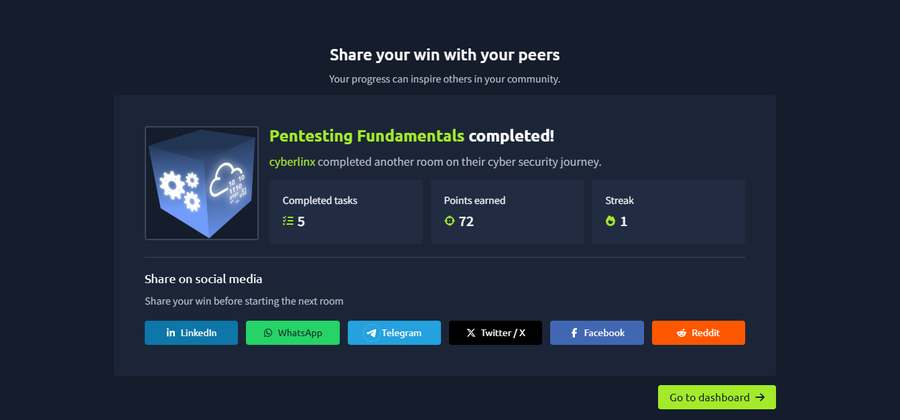
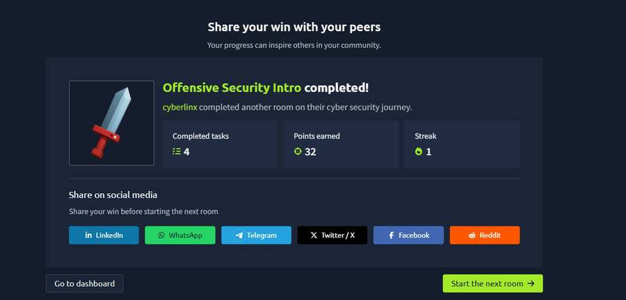
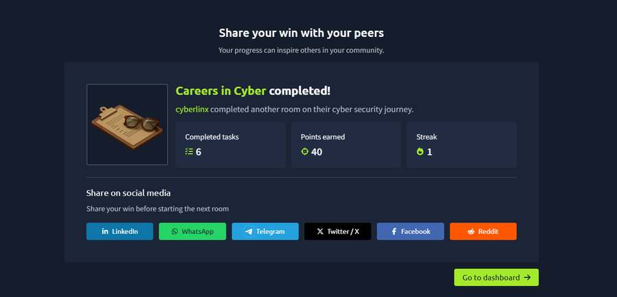

# Week 1, Task 1 — Cybersecurity and Ethical Hacking: Introduction

  
  
  

**Internship:** Ethical Hacking Internship, TechBiz Academy  
**Author:** Collins Okike

## 1. Introduction

In my first week of the internship, I learned the basics of cybersecurity and how ethical hacking helps identify security weaknesses.

Cybersecurity means protecting computers, networks, applications and data from people who should not have access to them. Ethical hacking is one part of cybersecurity. It involves testing a system with the owner's permission to find weaknesses before attackers can exploit them.

## 2. The CIA Triad

The CIA Triad explains three important parts of keeping information secure: Confidentiality, Integrity and Availability.

- **Confidentiality:** Only people who are allowed to see information should be able to access it. In a hospital, for example, only the staff treating a patient should be able to open that patient's records. Passwords, access controls and encryption help protect confidentiality.
- **Integrity:** Information should remain correct and should not be changed without permission. If someone changed the amount in a bank transfer, the bank's records could no longer be trusted. Hashing and digital signatures can help detect changes.
- **Availability:** Systems and data should be available when people need them. Backups and extra servers can help keep services running. DDoS attacks and ransomware can affect availability.

### Real example: WannaCry

In 2017, the WannaCry ransomware locked files on computers around the world. Hospitals in the UK had to cancel appointments because they could not use their systems. This mainly affected availability and showed me that cyberattacks can affect real people, not just computers.

## 3. Types of hackers

Hackers are often grouped by the colour of their hat. The main differences are permission and intention.

| Type | What I learned |
|---|---|
| **White hat** | Works with permission to improve security. Ethical hackers and penetration testers fall into this group. |
| **Black hat** | Attacks systems without permission to steal data, make money or cause damage. |
| **Grey hat** | May find and report a weakness without being asked, but still acts without permission and can break the law. |

What stood out to me is that ethical hackers and criminals may have similar technical skills. Permission, an agreed scope and proper reporting make a major difference.

## 4. The five phases of ethical hacking

The five phases I studied were:

1. **Reconnaissance:** Gathering information about a target, such as domain names, IP addresses, technology and publicly available information.
2. **Scanning:** Checking for live systems, open ports, services and known weaknesses. Tools such as Nmap and vulnerability scanners can be used for this stage.
3. **Gaining access:** Using a discovered weakness to access a system or application, only where it is allowed by the agreed scope.
4. **Maintaining access:** Checking whether access could be retained after the initial entry. In an authorized test, this must be controlled and documented.
5. **Covering tracks:** Real attackers may try to hide activity by deleting logs. In an ethical test, I should document what I do rather than hide it.

These phases also help defenders understand possible attacker behaviour. For example, repeated port scans in firewall logs may indicate scanning activity, while cleared security logs can be a sign of attempted concealment.

## 5. Penetration testing vs. vulnerability assessment

A vulnerability assessment identifies weaknesses and ranks them by severity. It often uses automated tools and does not exploit the weaknesses. A penetration test goes further by attempting to exploit selected weaknesses, within the agreed scope, to understand their potential impact.

| Area | Vulnerability assessment | Penetration test |
|---|---|---|
| Goal | Find and rank weaknesses | Show the real impact of selected weaknesses |
| Method | Often uses automated tools | Targeted testing, often with manual work |
| Exploitation | Identifies weaknesses without exploiting them | May exploit weaknesses within the approved scope |
| Result | Prioritized list of findings | Evidence, attack path and recommendations |

I learned that both approaches are useful: an assessment gives a wider view of weaknesses, while a penetration test demonstrates how some of them could be used. I also learned the terms black-box, grey-box and white-box testing, which describe how much information a tester receives before starting.

## 6. Ethics and rules of penetration testing

In the Pentesting Fundamentals room, I learned that penetration testing also involves legal responsibilities. Before a test begins, the tester and client agree on written permission, scope and rules. Going outside that scope can be illegal. I also came across testing methodologies such as OSSTMM and OWASP.

## 7. Cybersecurity career fields

I read about both offensive and defensive security work and some of the roles in cybersecurity.

| Role | Main responsibility |
|---|---|
| Penetration tester / red teamer | Tests systems with permission to find weaknesses and simulate attacker behaviour |
| Security Operations Centre (SOC) analyst | Monitors alerts and logs, investigates suspicious activity and reports incidents |
| Security engineer | Builds and maintains protections such as firewalls, access controls and secure configurations |
| Incident responder | Helps contain and recover from attacks and investigates what happened |
| Digital forensics examiner | Collects and studies evidence from devices and logs |
| Malware analyst | Studies malicious software to understand how it works and how to detect it |
| GRC analyst | Works on governance, risk, compliance, policies and audits |

## 8. Practical work — TryHackMe

I completed these three free TryHackMe rooms for this task.

### Pentesting Fundamentals

### Offensive Security Intro

### Careers in Cybersecurity

## 9. Conclusion

This task taught me the basic concepts I need for the rest of the internship. The CIA Triad helped me understand what security protects, the different types of hackers helped me understand the importance of permission, and the five phases showed me how an ethical hacking engagement can progress. I also learned the difference between identifying vulnerabilities and testing their impact. I want to keep practising these concepts in future labs.
