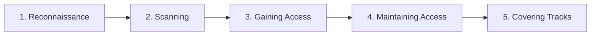

# WK 1 — Task 1: Cybersecurity & Ethical Hacking — Introduction

[← Back to Week 1](../README.md) · [Task 2 →](../Task%202/README.md) · [Task 3 →](../Task%203/README.md)

This task covers the foundational concepts in the Week 1 report. The notes below follow the submitted report and distinguish concepts studied from practical work.

---

# 🛡️ Task 1 — Cybersecurity and Ethical Hacking

## Objective

Understand the basic purpose of cybersecurity, the CIA Triad, different hacker types, the five phases of ethical hacking, and the distinction between vulnerability assessment and penetration testing.

## 1. The CIA Triad

The **CIA Triad** is a simple model for thinking about what security is meant to protect: confidentiality, integrity, and availability.

| Principle | Meaning | Real-world example | Security relevance |
|---|---|---|---|
| **Confidentiality** | Information is only accessible to people who are authorized to see it. | In a hospital, only staff with the appropriate access should be able to view a patient's records. | Access controls, strong authentication, and encryption help protect sensitive information. |
| **Integrity** | Information remains accurate and is not changed without authorization. | A bank transfer record must not be altered by an unauthorized person. | Hashes and digital signatures can help detect unauthorized changes. |
| **Availability** | Systems and information are accessible when authorized users need them. | Customers should be able to access an online banking service when it is needed. | Backups, resilient infrastructure, and recovery planning help maintain availability. |

### A real-world example: WannaCry

The WannaCry ransomware outbreak in 2017 disrupted computer systems around the world, including healthcare services in the United Kingdom. Some hospitals had to cancel appointments because systems and information were unavailable. This illustrates how a cyber incident can affect people and services, not just computers.

**My takeaway:** A system can have a security problem even if information has not been stolen. Unauthorized changes affect integrity, while an outage can affect availability.

## 2. White, Black, and Grey Hat Hackers

The main differences are **authorization, intention, and conduct**.

| Type | Authorization | Typical intention | Example |
|---|---|---|---|
| **White hat** | Has permission and works within an agreed scope. | Identify weaknesses and help improve security. | A penetration tester hired to test a company's website. |
| **Black hat** | Acts without authorization. | May steal information, make money illegally, disrupt services, or cause harm. | A criminal who deploys ransomware or steals payment details. |
| **Grey hat** | May find or test a weakness without permission, even if the intention is not malicious. | Often claims to expose a weakness or alert its owner. | Someone tests a website without being asked and then reports a discovered issue. |

A claimed good intention does not replace permission. Ethical testing requires authorization, an agreed scope, and responsible reporting.

## 3. Five Phases of Ethical Hacking

The five phases describe a common sequence used to explain how a security test or attack may progress.

| Phase | What it means | Example of the activity |
|---|---|---|
| **1. Reconnaissance** | Gather information about the target to understand its systems and possible exposure. | Reviewing public domain information and other permitted sources. |
| **2. Scanning** | Identify live systems, open ports, running services, and possible weaknesses. | Using Nmap or an authorized vulnerability scanner. |
| **3. Gaining Access** | Test whether a weakness can be used to access a system or application. | Validating a finding within the approved scope. |
| **4. Maintaining Access** | Assess whether access could persist after an initial compromise. | In a specifically authorized test, checking persistence risk and then removing test artifacts. |
| **5. Covering Tracks** | Understand how real attackers may attempt to conceal activity. | Defenders may look for deleted logs or other evidence of tampering. |

**Important ethical distinction:** Covering tracks describes attacker behaviour in the traditional five-phase model. During an authorized assessment, I should document my actions and preserve evidence rather than conceal my activity or delete logs.

## 4. Penetration Testing vs Vulnerability Assessment

These activities are related, but they answer different questions.

| Comparison | Vulnerability assessment | Penetration test |
|---|---|---|
| **Main goal** | Find and prioritize a broad range of weaknesses. | Test selected weaknesses to understand their real-world impact. |
| **Typical approach** | Often relies heavily on automated scanning and analysis. | Uses targeted manual testing and tools; automation may also be used. |
| **Exploitation** | Generally identifies weaknesses without attempting to exploit them. | May safely exploit weaknesses within the agreed scope. |
| **Output** | A prioritized list of findings and remediation guidance. | Evidence, validated attack paths, impact, and remediation advice. |
| **Useful question** | “What weaknesses may exist?” | “What could an attacker achieve through these weaknesses?” |

Both approaches are useful. An assessment provides visibility into possible weaknesses, while a penetration test helps validate the impact of selected findings. The testing scope and permission must be agreed before work begins.

Penetration tests may also be described as **black box** (the tester begins with little or no internal information), **grey box** (some information is supplied), or **white box** (substantial internal information is supplied).

## 5. Cybersecurity Career Paths

During this task, I explored several roles and how they contribute to security.

| Career path | Main responsibility |
|---|---|
| **Penetration Tester / Red Teamer** | Tests security with permission to identify weaknesses; red teams may simulate attacker behaviour across a broader engagement. |
| **SOC / Security Analyst** | Monitors alerts and logs, investigates suspicious activity, and escalates or reports incidents. |
| **Security Engineer** | Implements and maintains security controls, secure configurations, and protective technologies. |
| **Incident Responder** | Helps contain incidents, investigate what happened, and support recovery. |
| **Digital Forensics Examiner** | Collects and examines digital evidence from systems and logs. |
| **Malware Analyst** | Studies malicious software to understand its behaviour and how it can be detected. |
| **GRC Analyst** | Supports governance, risk management, policies, compliance activities, and audits. |

This overview helped me understand that cybersecurity includes both offensive testing and defensive work. The roles may overlap, but each has a different primary responsibility.

## 6. Learning Resources and Takeaways

I completed the following TryHackMe learning activities for this task:

- **[Pentesting Fundamentals](https://tryhackme.com/)** — introductory penetration-testing concepts.
- **[Intro to Offensive Security](https://tryhackme.com/)** — an introduction to offensive security.
- **Cybersecurity Careers** — an overview of different career paths.

The report also references beginner videos about ethical hacking and the CIA Triad.

**What I learned:** Cybersecurity is about protecting information and systems. Ethical hacking uses testing techniques with authorization to help identify weaknesses. The most important distinction is not simply which tools someone uses, but whether the work is authorized, scoped, documented, and reported responsibly.

---

