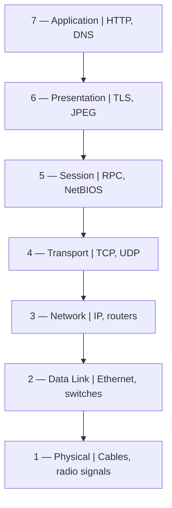

# WK 1 — Task 2: Networking Basics — IP, Ports, Protocols & OSI Model

[← Back to Week 1](../README.md) · [Task 1](../Task%201/README.md) · [Task 3 →](../Task%203/README.md)

This task records the networking concepts and checks covered in the Week 1 report.

---

# 🌐 Task 2 — Networking Basics

## Objective

Learn the networking concepts needed to understand how devices communicate and how security tools identify hosts, services, and network traffic.

## 1. IP and MAC Addresses

### What is an IP address?

An **Internet Protocol (IP) address** identifies a network interface for communication across an IP network. It helps traffic reach the intended destination.

- **IPv4** uses 32-bit addresses, commonly written as four decimal numbers separated by dots, such as `192.0.2.10`.
- **IPv6** uses 128-bit addresses, written in hexadecimal groups separated by colons, such as `2001:db8:85a3::8a2e:370:7334`.
- **Private IPv4 addresses** are used inside private networks and are not directly routed across the public internet.
- **Public IP addresses** are used for internet-facing communication, subject to the network's routing and configuration.

The three private IPv4 ranges are:

| Range | Common context |
|---|---|
| `10.0.0.0/8` | Large private networks |
| `172.16.0.0/12` | Private networks using the 172.16–172.31 range |
| `192.168.0.0/16` | Common home and small-office networks |

### What is a MAC address?

A **Media Access Control (MAC) address** identifies a network interface at the data-link layer. A typical Ethernet MAC address is 48 bits and is written as six hexadecimal pairs, for example `00:1A:2B:3C:4D:5E`.

A MAC address is useful for communication on a local network. It should not be treated as strong proof of a device's identity because addresses can sometimes be changed or spoofed.

### IP address vs MAC address

| Feature | IP address | MAC address |
|---|---|---|
| OSI association | Layer 3 — Network | Layer 2 — Data Link |
| Main purpose | Logical addressing and routing between networks | Local-network frame delivery |
| Format | IPv4 dotted decimal or IPv6 hexadecimal | Usually hexadecimal pairs |
| Can change? | Yes, depending on network configuration | Can be changed or spoofed in software on some interfaces |

A simple way to remember the difference: the IP address helps route traffic to a network destination, while the MAC address helps deliver a frame on the local network.

## 2. The Seven OSI Layers

The **Open Systems Interconnection (OSI) model** divides network communication into seven layers. It provides a structured way to discuss protocols, network behaviour, and troubleshooting.



| Layer | Name | Purpose | Example |
|---:|---|---|---|
| **7** | Application | Provides network services used by applications. | HTTP, DNS |
| **6** | Presentation | Handles data representation, encoding, compression, and encryption-related functions. | TLS-related presentation functions, JPEG |
| **5** | Session | Manages conversations or sessions between communicating systems. | RPC, NetBIOS session services |
| **4** | Transport | Supports communication between applications and uses port numbers. | TCP, UDP |
| **3** | Network | Handles logical addressing and routing. | IP, routers |
| **2** | Data Link | Moves frames across a local link using link-layer addressing. | Ethernet, switches |
| **1** | Physical | Carries raw bits as electrical, optical, or radio signals. | Cables, radio signals |

**Memory aid:** All People Seem To Need Data Processing — Application, Presentation, Session, Transport, Network, Data Link, Physical.

When data is sent, it moves down the conceptual layers at the sender and back up the layers at the receiver. Each layer contributes information needed for delivery. This process is commonly described as **encapsulation** and **decapsulation**.

### Why the OSI model matters for security

The model helps organize investigations. For example, an analyst may examine physical connectivity at Layer 1, local-network behaviour at Layer 2, IP routing at Layer 3, transport connections and ports at Layer 4, or web application activity at Layer 7. The model is a troubleshooting aid rather than a claim that every attack belongs to only one layer.

## 3. Common Ports and Services

A **port** helps a host direct network traffic to the relevant service or application. Port numbers range from 0 to 65535.

| Port | Service | Transport | Common use | Security consideration |
|---:|---|---|---|---|
| **20** | FTP data | TCP | FTP data transfer in traditional active FTP | Traditional FTP does not encrypt traffic by default. |
| **21** | FTP control | TCP | FTP commands and session control | Credentials and data may be exposed without additional protection. |
| **22** | SSH | TCP | Secure remote login and administration | Protect credentials and keys; monitor suspicious login attempts. |
| **23** | Telnet | TCP | Traditional remote terminal access | Usually unencrypted; SSH is generally preferred. |
| **25** | SMTP | TCP | Mail transfer between mail servers | Misconfiguration can contribute to spam or mail abuse. |
| **53** | DNS | UDP and TCP | Resolves domain names and supports DNS queries | Monitor for unusual queries, tunnelling, or configuration issues. |
| **80** | HTTP | TCP | Web traffic without TLS | Traffic is not encrypted by HTTP alone. |
| **443** | HTTPS | TCP | Web traffic protected with TLS | Encryption does not make a website or service inherently trustworthy. |
| **110** | POP3 | TCP | Email retrieval | Use secure configurations; traditional POP3 is unencrypted without TLS. |
| **3389** | RDP | TCP (commonly) | Windows Remote Desktop | Restrict exposure and protect remote access with strong controls. |

Port numbers indicate common service conventions, not certainty. A service can run on a non-standard port, and seeing a port open does not by itself prove that a system is vulnerable.

### What I noticed

- SSH (22) is generally preferred over Telnet (23) because SSH provides encrypted remote administration.
- HTTPS (443) protects traffic in transit with TLS, while HTTP (80) does not provide that protection by itself.
- DNS can use both UDP and TCP.
- Unexpected exposure of remote administration services, including RDP, deserves investigation.
- A scan result needs context: the service, configuration, exposure, and business need all affect the security assessment.

## 4. TCP vs UDP

TCP and UDP operate at the transport layer and use ports, but they handle delivery differently.

| Feature | TCP | UDP |
|---|---|---|
| Connection | Connection-oriented; uses a handshake | Connectionless at the transport layer |
| Delivery | Acknowledgements and retransmissions support reliable delivery | UDP itself does not guarantee delivery |
| Ordering | Supports ordered delivery | Does not guarantee packet order |
| Overhead | More transport-level mechanisms and overhead | Smaller basic header and lower protocol overhead |
| Common uses | HTTPS, SSH, SMTP, file transfers | DNS queries, voice/video applications, online games |

### TCP three-way handshake

A typical TCP connection begins with a three-way handshake:

```text
Client                         Server
  | -------- SYN -------------> |
  | <------ SYN-ACK ----------- |
  | -------- ACK -------------> |
  |       Connection ready     |
```

TCP uses this process to establish a connection before exchanging application data.

### Three key differences

1. **Connection setup:** TCP establishes a connection; UDP does not require a transport-layer handshake.
2. **Reliability and order:** TCP supports reliable, ordered delivery through acknowledgements and retransmissions. UDP does not provide those guarantees itself.
3. **Overhead and use cases:** UDP has a smaller basic header and may suit latency-sensitive traffic. TCP's additional mechanisms suit applications that need reliable delivery.

UDP is not automatically faster in every situation, and applications using UDP may implement their own reliability or security features.

## 5. Networking Practice and Takeaways

For this task, I used Windows Command Prompt to inspect the host's network configuration:

```bat
ipconfig
ipconfig /all
```

I checked the IPv4 Address, Subnet Mask, Default Gateway, IPv6 information, DHCP details, and Physical Address fields in the output.

The original task listed the TryHackMe rooms *What is Networking?*, *OSI Model*, and *Packets & Frames*. My report records that I completed **What is Networking?**, and used **Networking Concepts** and **Intro to LAN** as free alternatives for material that was not accessible to my free account at the time.

**What I learned:** Understanding addressing, ports, protocols, and layers helps me interpret scan results and network logs. These concepts are important for both penetration testing and defensive monitoring.

---

