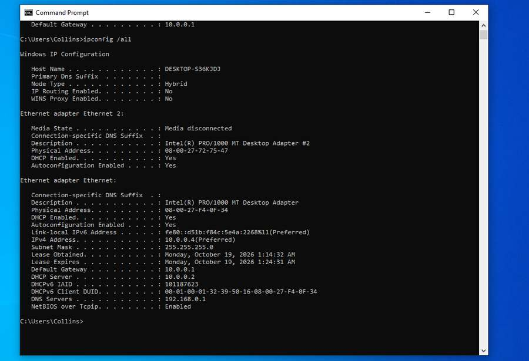
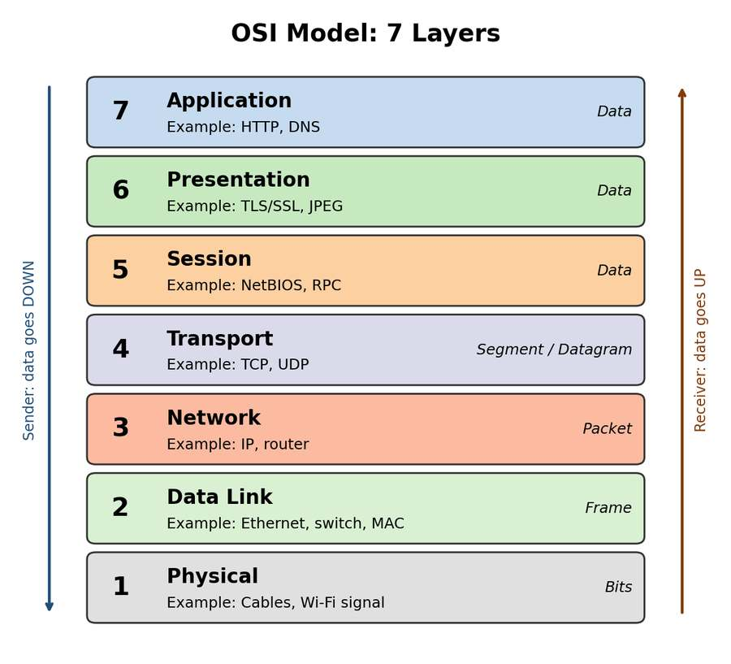
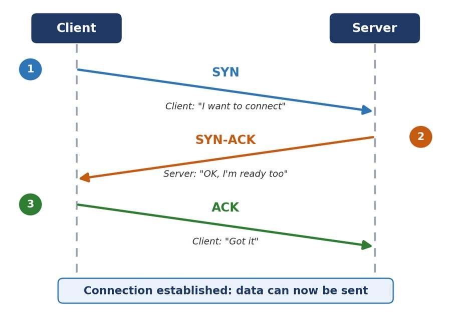
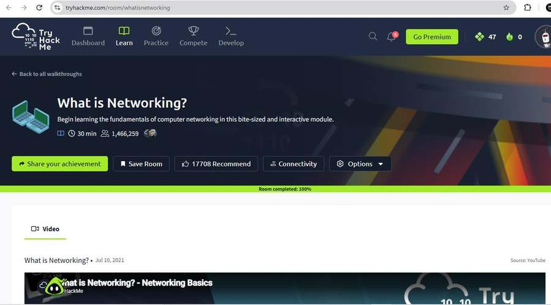
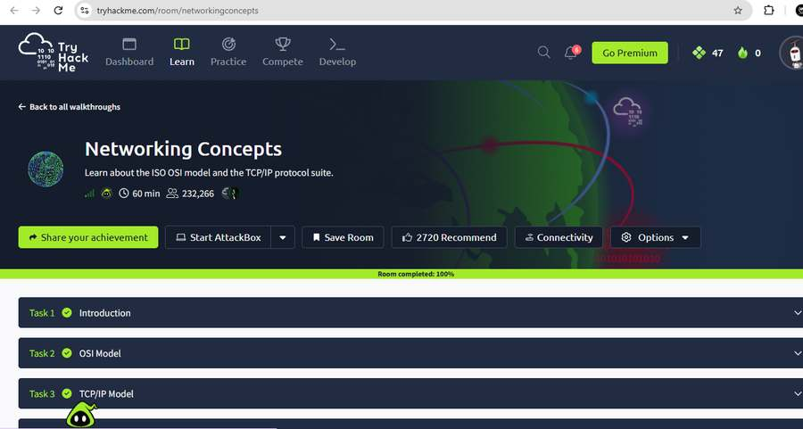
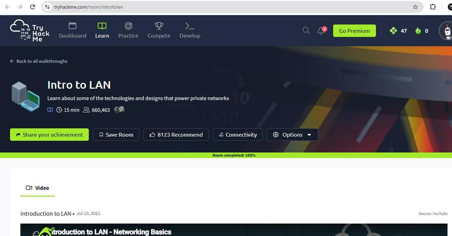

# Week 1, Task 2 — Networking Basics: IP, Ports, Protocols & OSI Model

  
  
  
  

  <a href="../README.md">← Week 1 overview</a>
  &nbsp;·&nbsp;
  <a href="../Task%201/README.md">← Task 1</a>
  &nbsp;·&nbsp;
  <a href="../Task%203/README.md">Next: Task 3 →</a>
  &nbsp;·&nbsp;
  <a href="../Evidence/README.md">Evidence index</a>

**Internship:** Ethical Hacking, TechBiz Academy  
**Author:** Collins Okike

## 1. Introduction

For this task I learned the basics of networking, which is important for ethical hacking. Before I can test or protect a network, I need to understand how devices find each other and send data. I covered IP addresses, MAC addresses, the OSI model, common ports, and the differences between TCP and UDP.

I completed the TryHackMe rooms **What is Networking?**, **Networking Concepts** and **Intro to LAN**. I used Networking Concepts and Intro to LAN as free alternatives for the premium OSI Model and Packets & Frames rooms. I also watched videos about the OSI model and IP addresses and ports, and checked my Windows computer's private IP from the command line.

## 2. IP addresses and MAC addresses

### IPv4 vs. IPv6

An IP address identifies a device on a network and helps route data to it. IPv4 is 32 bits long and is written as four numbers separated by dots. IPv6 is 128 bits long and uses hexadecimal groups separated by colons. IPv6 was introduced partly because IPv4 addresses were running out; groups of zeros can also be shortened using `::`.

| Feature | IPv4 | IPv6 |
|---|---|---|
| Size | 32 bits | 128 bits |
| Format | Four decimal numbers separated by dots | Hexadecimal groups separated by colons |
| Example | `192.0.2.10` | `2001:0db8:85a3::8a2e:0370:7334` |

### Private and public IP addresses

A private IP address is used inside a local network, while a public IP address is used for communication across the internet. The private IPv4 ranges I studied are:

- `10.0.0.0 – 10.255.255.255`
- `172.16.0.0 – 172.31.255.255`
- `192.168.0.0 – 192.168.255.255`

### Finding my Windows IP address

I opened Command Prompt and ran `ipconfig`, then used `ipconfig /all` to see more details. My recorded results included:

| Field | Result | What I understood |
|---|---|---|
| IPv4 address | `10.0.0.4` | A private address in the `10.0.0.0/8` range |
| Subnet mask | `255.255.255.0` | Identifies the network and host parts of the address |
| Default gateway | `10.0.0.1` | The gateway used to reach networks outside the local subnet |
| Link-local IPv6 | `fe80::d51b:f84c:5e4a:2268` | An IPv6 address for local-link communication |
| Physical address (MAC) | `08-00-27-F4-0F-34` | The MAC address recorded for my Ethernet adapter |
| DHCP server | `10.0.0.2` | The server that automatically assigned the address |

A MAC address identifies a network interface at the data-link layer. It is typically shown as six pairs of hexadecimal characters. I learned that MAC addresses can be spoofed, so they should not be treated as complete proof of a device's identity.

I think of the IP address like a street address used to reach a destination, while the MAC address helps deliver traffic between devices on the same local network. ARP helps find the MAC address associated with an IPv4 address on a local network.

## 3. The OSI model — seven layers

The OSI model breaks network communication into seven layers. It helps me understand where a problem may be happening and which kind of tool or log could be useful when investigating it. I used the phrase **“All People Seem To Need Data Processing”** to remember the order from Application down to Physical.

| Layer | Name | Example |
|---:|---|---|
| 7 | Application | HTTP, DNS |
| 6 | Presentation | TLS/SSL, JPEG |
| 5 | Session | NetBIOS, RPC |
| 4 | Transport | TCP, UDP |
| 3 | Network | IP, router |
| 2 | Data Link | Ethernet, switch |
| 1 | Physical | Cables, Wi-Fi signal |

When data is sent, it moves down the layers and receives additional information at each stage. This is called encapsulation. At the receiving end, the process reverses as the data moves back up the layers.

The model also helped me connect network layers to security examples. A cable issue is related to Layer 1, a MAC-spoofing or ARP issue to Layer 2, an IP or routing issue to Layer 3, port scanning to Layer 4, and a problem such as SQL injection to the application layer.

## 4. Common ports and services

A port is a number used to direct network traffic to the correct service or application on a device. The ports I reviewed for this task are:

| Port | Service | Common use | Security note |
|---:|---|---|---|
| 20 | FTP data | File transfer data | Not encrypted by default |
| 21 | FTP control | FTP commands and login | Credentials can be exposed without encryption |
| 22 | SSH | Secure remote login and file transfer | Encrypted, but can be targeted by brute-force attempts |
| 23 | Telnet | Remote login | Not encrypted by default |
| 25 | SMTP | Sending email between mail servers | Can be abused if poorly configured |
| 53 | DNS | Resolves domain names to IP addresses | Can be abused for tunnelling or spoofing |
| 80 | HTTP | Websites | Not encrypted by default |
| 443 | HTTPS | Websites using TLS | Encrypts traffic, but can also carry malicious traffic |
| 110 | POP3 | Downloading email | Not encrypted unless protected with TLS |
| 3389 | RDP | Windows Remote Desktop | Often targeted when exposed to the internet |

I noticed that some services have safer alternatives. SSH is safer than Telnet for remote access, and HTTPS protects web traffic with TLS while HTTP does not. DNS can use both UDP and TCP. Open ports are useful to know about because attackers look for exposed services, while defenders monitor unexpected connections.

## 5. TCP vs. UDP

TCP and UDP operate at the Transport layer, but they handle data differently.

### TCP three-way handshake

TCP establishes a connection using SYN, SYN-ACK and ACK before data is sent.

TCP supports reliable, ordered delivery through acknowledgements and retransmissions. It is commonly used for web traffic, email and file transfers.

UDP is connectionless and sends datagrams without establishing a transport connection first. UDP itself does not guarantee delivery, retransmission or packet order. It is often used for DNS lookups, live streaming, voice/video calls and online games where lower overhead or latency can be useful.

| Feature | TCP | UDP |
|---|---|---|
| Connection | Connection-oriented | Connectionless |
| Delivery | Reliable, ordered delivery is supported | No delivery or ordering guarantee from UDP itself |
| Overhead | More transport-level mechanisms | Lower basic overhead |
| Examples | HTTP, HTTPS, FTP, SSH, SMTP | DNS, streaming, VoIP, gaming |

I also learned that TCP scans can use handshake responses to help identify services, while UDP scans may take longer and can be less clear when services do not reply.

## 6. TryHackMe rooms

These are the three rooms I completed for this task. I used the two free alternatives because **OSI Model** and **Packets & Frames** were premium rooms.

### What is Networking?

### Networking Concepts

### Intro to LAN

What I took from these rooms was a better understanding of how devices connect, the roles of IP and MAC addresses, what different network layers do, and how local networks are organized.

## 7. Conclusion

After this task I understand more clearly how data travels across a network. I can explain the difference between IPv4 and IPv6, IP and MAC addresses, the seven OSI layers, common ports, and TCP versus UDP. I also understand why exposed ports and unencrypted services can create security risks. Next, I want to practise by looking at network traffic and checking the open ports on my own lab machine.
