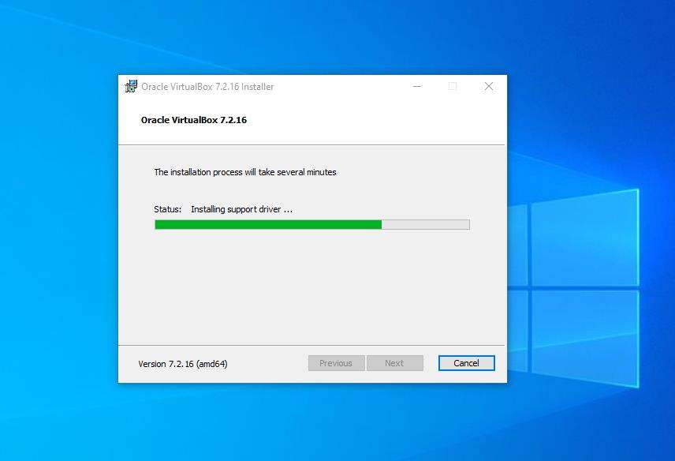
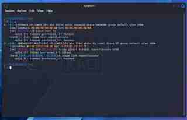

# Week 1, Task 3 — Building a Hacking Lab: VirtualBox and Kali Linux

**Internship:** Ethical Hacking, TechBiz Academy  
**Author:** Collins Okike

## 1. Introduction

The goal of this task was to build a basic cybersecurity lab on my computer. I used VirtualBox to run Kali Linux as a virtual machine. A virtual machine gives me a separate environment where I can practise Linux commands and security tools without installing Kali as my main operating system.

For this task I installed VirtualBox, downloaded the pre-built Kali Linux VirtualBox image, imported and started the virtual machine, explored the Kali desktop, and ran terminal commands to check my user, network interfaces and package information. I also completed the free TryHackMe room **Linux Fundamentals Part 1**.

## 2. Tools and resources

| Tool or resource | How I used it |
|---|---|
| Oracle VirtualBox 7.2.16 | Ran Kali Linux as a virtual machine on my Windows 10 computer |
| Kali Linux VirtualBox image | Imported a pre-built Kali environment |
| 7-Zip | Extracted the downloaded Kali files |
| Kali Terminal | Ran the Linux commands for this task |
| TryHackMe: Linux Fundamentals Part 1 | Practised basic Linux commands |
| Setup videos | Used as extra guidance for the installation and first-time setup |

## 3. Installing VirtualBox

I downloaded VirtualBox 7.2.16 from the official VirtualBox website and ran the installer on my Windows 10 computer using the default options. During installation, the installer showed the status **“Installing support driver.”**



After installation, I opened VirtualBox Manager.


## 4. Importing and starting Kali Linux

I went to the Kali Linux website, opened the Virtual Machines section, and downloaded the pre-built VirtualBox 64-bit image. I chose the pre-built image so I could import the system instead of performing a full installation from scratch.

I extracted the downloaded file with 7-Zip, opened VirtualBox, selected the option to open or import an existing virtual machine, and added the Kali `.vbox` file. I checked that the Kali VM appeared in VirtualBox Manager.


I started the VM and logged in with the default username and password shown in my report: `kali` / `kali`. The Kali desktop loaded, and I opened a terminal.


## 5. Terminal commands and results

### Checking the current user

I ran:

```bash
whoami
```

The output was `kali`, confirming that I was logged in as the normal Kali user rather than root.


### Checking network interfaces

I ran:

```bash
ip a
```

The command displayed the network interfaces and their addressing details. My recorded result for `eth0` was:

| Field | Result |
|---|---|
| Interface | `eth0` |
| IPv4 address | `10.0.0.3/24` |
| MAC address | `08:00:27:63:b0:05` |
| IPv6 address | `fe80::a413:d56d:1797:240/64` |
| Loopback address | `127.0.0.1` |



The `lo` interface is the loopback interface, which lets the computer communicate with itself. The `10.0.0.3/24` address is a private IPv4 address. The MAC address belongs to the VM's virtual network adapter, and the IPv6 address beginning with `fe80` is link-local.

### Updating package information

I ran:

```bash
sudo apt update
```

The command refreshed the list of available packages from the configured Kali repositories. It asked for my password, and the command finished without errors in the recorded session. This command refreshes package information; it does not upgrade the installed packages by itself.


## 6. TryHackMe — Linux Fundamentals Part 1

I completed the free **Linux Fundamentals Part 1** room on TryHackMe. It introduced basic Linux commands that I will need when working in the Kali terminal.


Some of the commands and operators I covered were:

| Command or operator | What it does |
|---|---|
| `whoami` | Shows the current username |
| `echo` | Prints text |
| `ls` | Lists files and folders |
| `cd` | Changes directory |
| `cat` | Displays a file's contents |
| `pwd` | Shows the current working directory |
| `find` | Searches for files |
| `grep` | Searches for text inside files |
| `&` | Runs a command in the background |
| `&&` | Runs the next command only if the previous one succeeds |
| `>` | Writes output to a file, replacing existing content |
| `>>` | Appends output to a file |

These commands are useful for moving around a system, finding files, searching logs and saving command output.

## 7. Conclusion

I installed VirtualBox, imported Kali Linux, logged in and ran my first commands. The commands confirmed my current user, showed my VM's network settings and refreshed the package list. Completing Linux Fundamentals Part 1 also introduced me to commands I will keep using in the terminal. My lab is ready for the next tasks, and the screenshots above show the installation and command results recorded in my Week 1 report.
