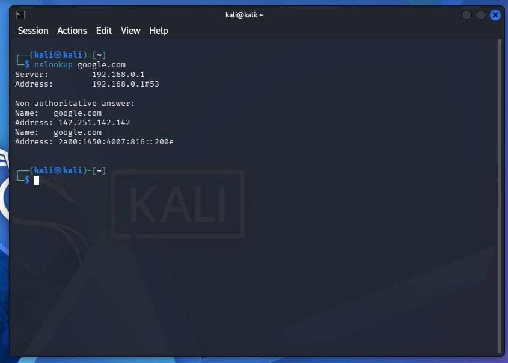
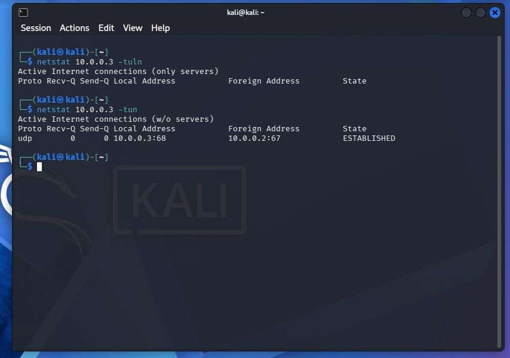
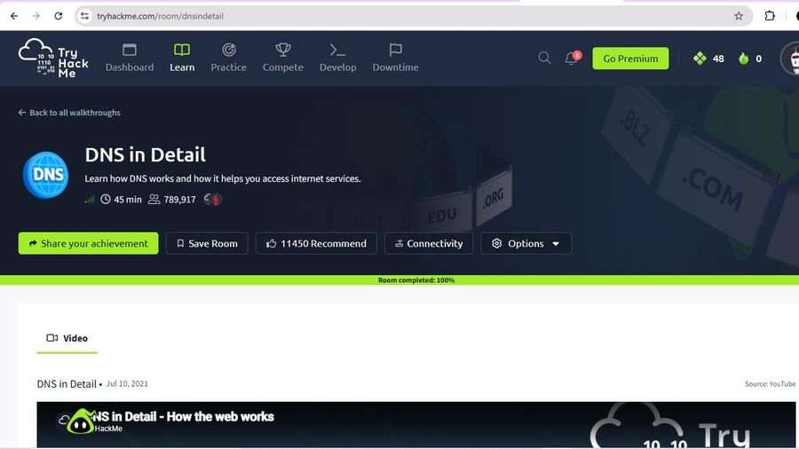
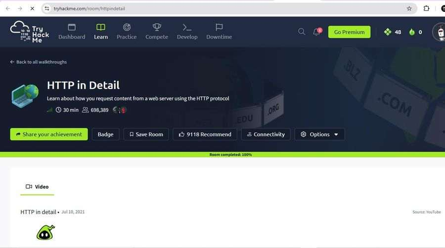

# Week 2, Task 2 — Networking Tools & Subnetting Basics

  
  
  

**Internship:** Ethical Hacking Internship, TechBiz Academy  
**Author:** Collins

## 1. Introduction

For this task I practised the basic networking tools I need to know before scanning. I worked with \`ping\`, \`traceroute\`, \`nslookup\`, \`dig\` and \`netstat\`, and I learned the basics of subnetting. I ran the commands in my Kali Linux VM and completed the two TryHackMe rooms for this week.

## 2. Ping

I used \`ping\` to send ICMP echo requests and check whether a host replied.

\`\`\`bash
ping -c 4 google.com
\`\`\`

The \`-c 4\` option stopped the command after four packets.

**My result:** \`google.com\` resolved to \`142.251.142.142\`. All four packets returned, so packet loss was **0%**. The reply times were 134, 133, 147 and 135 ms. The summary showed a minimum of 133.036 ms, an average of 137.202 ms and a maximum of 146.918 ms. The TTL in every reply was 64.

I learned that ping helps me check reachability and round-trip time. A failed ping does not always mean a host is down, because a firewall may block ICMP replies.

## 3. Traceroute

I used traceroute to see the path my packets took towards Google.

\`\`\`bash
traceroute google.com
\`\`\`

Each line represents a hop. The tool sends probes with increasing TTL values so I can see which routers respond along the path.

**My result:** The trace used destination address \`192.178.25.110\`, with a maximum of 30 hops and 60-byte packets. Hop 1 was my gateway, \`10.0.0.1\`, and it responded in under 1 ms (0.806, 0.772 and 0.746 ms). Hops 2 through 30 showed \`* * *\`, giving 29 timeouts. The trace did not reach Google.

The destination IP differed from the IP in my ping test. I noted that Google can have multiple IP addresses. I was not completely sure why the later probes did not receive replies; a firewall or the VM network may have blocked them. My successful ping showed that the timeouts did not mean I had no internet connection.

## 4. DNS lookup — nslookup and dig

I used both tools to ask a DNS server for the addresses associated with \`google.com\`.

\`\`\`bash
nslookup google.com
dig google.com
\`\`\`

### nslookup

The DNS server was \`192.168.0.1\` on port 53. The response was marked non-authoritative. It returned the IPv4 address \`142.251.142.142\` and IPv6 address \`2a00:1450:4007:816::200e\`.

### dig

The status was \`NOERROR\` and there was one answer. The ANSWER SECTION contained an A record for \`google.com\` pointing to \`142.251.142.142\`, with a TTL of 123 seconds. The query took 44 ms, and the response came from \`192.168.0.1#53\` over UDP.

The IP address from nslookup and dig matched the one from my ping test. Traceroute returned a different IP, which I recorded in the report.

## 5. Netstat

I used netstat to look at listening ports and active network connections on my Kali machine.

\`\`\`bash
netstat -tuln
netstat -tun
\`\`\`

The options I used were \`-t\` for TCP, \`-u\` for UDP, \`-l\` for listening sockets and \`-n\` to show numerical addresses and ports. I also typed my machine's IP address after the command in the screenshot, but netstat did not need it.

**My result:**

- \`netstat -tuln\` showed only the header and no entries. In that output, there were no TCP or UDP services listening.
- \`netstat -tun\` showed a UDP entry from \`10.0.0.3:68\` to \`10.0.0.2:67\`, with the state displayed as \`ESTABLISHED\`. I identified ports 68 and 67 as the DHCP client and server ports, so I recorded this as the VM's DHCP traffic.

I learned that netstat can help me review listening ports and connections to unfamiliar addresses. I also noted that UDP itself is connectionless, even though the output displayed the state shown above.

## 6. Subnetting basics

An IPv4 address contains 32 bits. The subnet mask determines how many bits belong to the network and how many remain for host addresses. CIDR notation expresses the network portion as a slash number. For example, \`/24\` leaves 8 host bits.

The formula I used was:

\`\`\`text
Usable hosts = 2^(host bits) - 2
\`\`\`

I subtract two for the network address and broadcast address.

### Solved example: 192.168.1.0/24

| Step | My working |
|---|---|
| Host bits | 32 - 24 = 8 |
| Subnet mask | 255.255.255.0 |
| Total addresses | 2^8 = 256 |
| Usable hosts | 256 - 2 = 254 |
| Network address | 192.168.1.0 |
| Usable range | 192.168.1.1 to 192.168.1.254 |
| Broadcast address | 192.168.1.255 |

My answer was **254 usable hosts** in a \`/24\` network.

### Quick reference table

| CIDR | Subnet mask | Total addresses | Usable hosts |
|---|---|---:|---:|
| /24 | 255.255.255.0 | 256 | 254 |
| /25 | 255.255.255.128 | 128 | 126 |
| /26 | 255.255.255.192 | 64 | 62 |
| /27 | 255.255.255.224 | 32 | 30 |
| /30 | 255.255.255.252 | 4 | 2 |

I learned that a smaller number after the slash represents a larger network. Before scanning, I need to understand how many hosts may be inside the range I am allowed to test.

## 7. TryHackMe rooms

I completed two free TryHackMe rooms for this task.

### DNS in Detail

I learned about domain structure, DNS record types and how DNS resolution works. The room covered A records for IPv4, AAAA records for IPv6, CNAME records for aliases, MX records for mail servers and TXT records for text information. I also studied recursive DNS resolution involving root, TLD and authoritative DNS servers.

### HTTP in Detail

I learned that HTTP uses a request-and-response model. I reviewed the GET and POST methods, common status codes (200, 301, 403, 404 and 500), and headers such as User-Agent, cookies and content type.

## 8. Conclusion

In this task I learned how to check whether a host is reachable with ping, view the route towards it with traceroute, find domain addresses with nslookup and dig, and review local connections with netstat. I also worked through a subnetting example by hand.

Subnetting was the part I found hardest because there were several steps to keep in the right order. Working through the \`/24\` example helped me understand the network bits, host bits and why I subtract two. These skills come before scanning because they help me understand the range I am testing, how traffic gets there and how to read the results. My next step is to use these skills with Nmap.
