# Week 3, Task 1 — Footprinting & OSINT (Passive Reconnaissance)

  
  
  

**Internship:** Ethical Hacking Internship, TechBiz Academy  
**Author:** Collins Okike  
**Target in the report:** \`techbiz-sec.com\`

## 1. Introduction

Footprinting or reconnaissance is the information-gathering phase that comes before scanning and later testing. This task focused on **passive reconnaissance**, also called Open Source Intelligence (OSINT). I collected information from public sources such as search engines, domain records, certificate transparency logs, DNS lookup services and archived web pages. I did not send scans, login attempts or exploits to the target.

Passive reconnaissance is also useful from a defender's perspective. It helps an organization understand what an attacker could learn about its public footprint before any direct interaction with its systems.

## 2. Objective, scope and ethical boundary

The objective was to practise passive reconnaissance on one public domain and document the results. The work covered:

- A WHOIS lookup and registrant information.
- Three Google dorks using \`site:\`, \`filetype:\` and \`inurl:\`.
- Email, hostname, subdomain and IP collection with theHarvester.
- Public OSINT sources: Shodan, crt.sh, DNSDumpster, Hunter.io, Wayback Machine and OSINT Framework.
- The TryHackMe rooms Passive Reconnaissance, Google Dorking, OhSINT and Shodan.io.

The scope remained \`techbiz-sec.com\` and public information only. The report does not claim to have confirmed vulnerabilities. Information shown by third-party lookup services is recorded as returned by those services, not as the result of a direct scan by me. Any active testing beyond this task would require written permission from the domain owner.

## 3. Tools and methods

| Tool | Purpose in this task | Use recorded in the report |
|---|---|---|
| \`whois\` / whois.com | Domain registration, registrar, dates and name servers | Used |
| Google dorks | Search indexed pages and files with \`site:\`, \`filetype:\` and \`inurl:\` | Used |
| theHarvester | Collect public emails, subdomains, hostnames and IP addresses | Used |
| crt.sh | Search certificate transparency records | Used |
| DNSDumpster | Review DNS records, hostnames and reported services | Used |
| Shodan | Search indexed internet-connected services | Used; no results for the searched domain |
| Hunter.io | Review public email addresses and company email format | Not used; required an account with a professional email address |
| Wayback Machine | Review archived versions of a website | Used |
| OSINT Framework | Directory of OSINT tools by category | Consulted as a reference; no screenshot was included |

## 4. WHOIS lookup

I looked up \`techbiz-sec.com\` on whois.com and recorded the registration details shown in the result.

| Field | Recorded result |
|---|---|
| Domain | \`techbiz-sec.com\` |
| Registrar | HOSTINGER operations, UAB (IANA ID 1636) |
| Creation date | 2024-10-11 |
| Last updated / expiry | 2024-10-11 / 2027-10-11 |
| Domain status | \`client transfer prohibited\` |
| Name servers | \`ns1.dns-parking.com\`, \`ns2.dns-parking.com\` |
| Registrar abuse contact | \`abuse-tracker@hostinger.com\`, \`+37064503378\` |
| Registrant details | No name or organisation displayed; country \`LT\` and a Hostinger contact-form link were shown |

The transfer-prohibited status indicates that the domain is locked against transfer unless the owner unlocks it. The registrant's personal details were not displayed in the lookup. The abuse email and phone number belong to the registrar, not to the domain owner. The name servers were also returned by DNSDumpster later in the task.

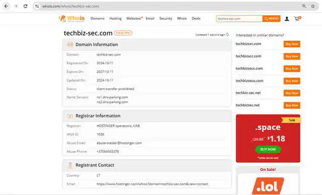

## 5. Google dorking

I used three Google search operators to check what the search engine had indexed for the target.

### 5.1 \`site:techbiz-sec.com\`

This search returned the home page, a Resources page about browser extensions (LeadForge), a Contact Us page and additional resource pages. The Contact Us search snippet displayed the public email \`info@techbiz-sec.com\`, a phone number and a location. The report treats these as business contact details that are meant to be public, while noting that they could also be useful to someone preparing phishing or social-engineering attempts.

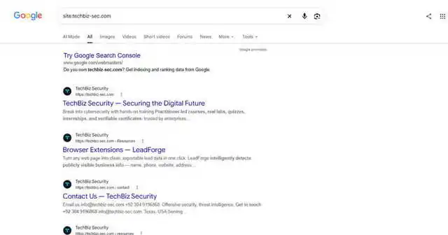

### 5.2 \`site:techbiz-sec.com filetype:pdf\`

This search returned three PDF files in an \`/outlines\` folder: course outlines for SOC Analyst (Blue Team Operations), Certified Ethical Hacker (CEH v13) and Cisco CCNA 200-301. They appeared to be public marketing/course documents, and I did not identify sensitive information in the search results. The folder name also gave an indication of how the site organised these files.

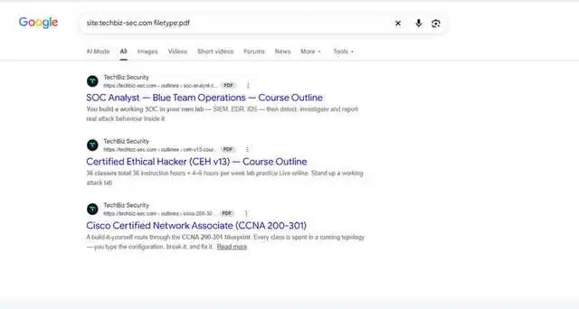

### 5.3 \`site:techbiz-sec.com inurl:login\`

Google returned no matching documents for the target. This means that the search did not show an indexed page with \`login\` in its URL; it does **not** prove that the website has no login page.

For comparison only, I ran \`site:tryhackme.com inurl:login\`. That search showed a public login page and room pages that mention login. TryHackMe was only a comparison example, not the target of this assessment.

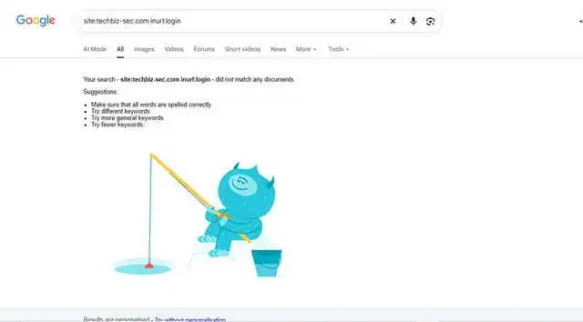

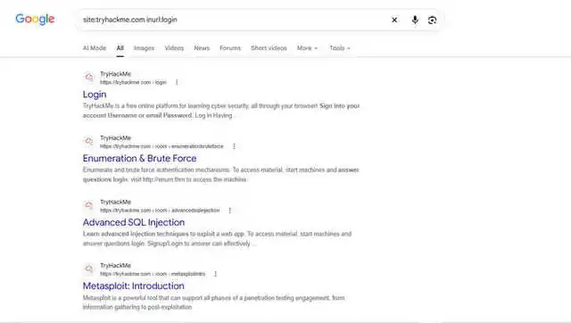

## 6. theHarvester

I ran the following command in Kali Linux:

\`\`\`bash
theHarvester -d techbiz-sec.com -b all
\`\`\`

\`-d\` specifies the domain, and \`-b all\` asks theHarvester to use all supported data sources. The tool version recorded in the report was **4.11.1**. Many sources required API keys that I had not configured, so they returned missing or invalid API-key messages and were skipped. A work-item \`TypeError\` also appeared, but the tool completed and printed results.

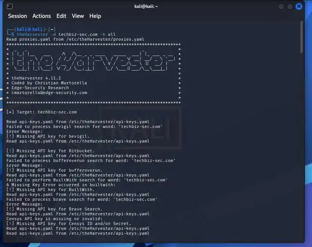

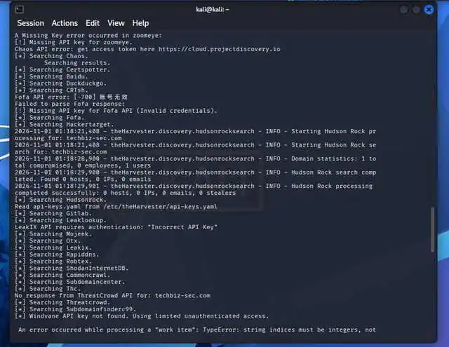

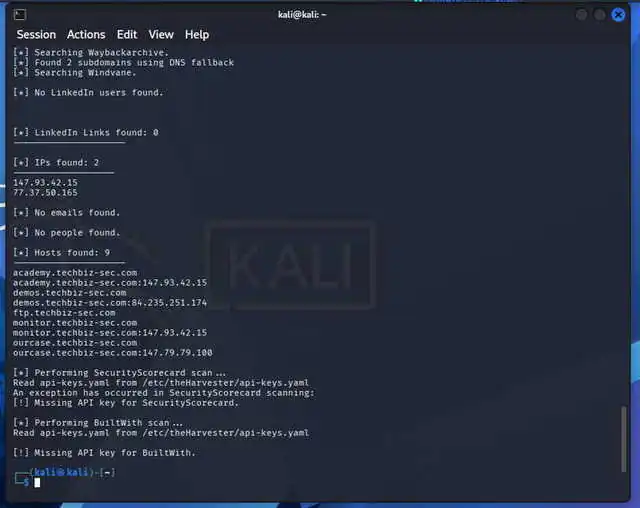

### Results recorded

| Item | Result |
|---|---|
| Emails | None; the tool printed \`No emails found\` |
| People / LinkedIn | No people found; 0 LinkedIn links |
| IPs found | \`147.93.42.15\` and \`77.37.50.165\` |
| Host entries | 9 entries representing 5 distinct hostnames: \`academy\`, \`demos\`, \`ftp\`, \`monitor\` and \`ourcase\` |
| IPs shown beside hostnames | \`academy\` and \`monitor\`: \`147.93.42.15\`; \`demos\`: \`84.235.251.174\`; \`ourcase\`: \`147.79.79.100\` |
| Sources with API-key issues | Examples included BuiltWith, Censys, Brave Search, Zoomeye, Fofa and LeakIX |

TheHarvester did not return emails even though the Google search in the previous section showed the public contact email. This demonstrated that one collection tool can miss information found by another. The hostname \`ftp.techbiz-sec.com\` appeared in theHarvester results but not in my DNSDumpster list. The second IP address, \`77.37.50.165\`, was also not present in the DNSDumpster results captured for this task. These differences are reasons to compare several sources rather than depend on one result set.

## 7. Other OSINT sources

### 7.1 crt.sh — certificate transparency

I searched for the exact identity \`techbiz-sec.com\` on crt.sh. The captured results showed certificates issued from **2024-10-11** through **2026-10-05**, with the newest certificate valid until **2027-01-03**. The issuers shown included Let's Encrypt (R10, R12, R13, YR1 and YE2) and ZeroSSL (RSA Domain Secure Site CA). The captured exact-domain results showed \`techbiz-sec.com\`; I did not see a subdomain in the portion captured. A wildcard search such as \`%.techbiz-sec.com\` could be used to look for subdomain certificates.

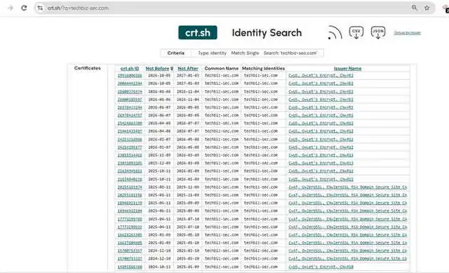

The first certificate date matched the WHOIS creation date recorded earlier. The certificate list showed repeated renewals, which I interpreted as consistent with certificates being renewed periodically. The exact-domain search and a wildcard subdomain search are different queries, so the absence of subdomains in this captured result is not proof that none exist.

### 7.2 DNSDumpster

DNSDumpster returned five hostnames with A records: \`www.techbiz-sec.com\`, \`academy.techbiz-sec.com\`, \`monitor.techbiz-sec.com\`, \`ourcase.techbiz-sec.com\` and \`demos.techbiz-sec.com\`.

| Item | DNSDumpster result captured in the report |
|---|---|
| Hostinger network / ASN | ASN 47583; IPs \`147.93.42.15\`, \`147.79.79.98\` and \`147.79.79.100\` |
| \`demos.techbiz-sec.com\` | Oracle network, ASN 31898; IP \`84.235.251.174\`; location shown as United Arab Emirates |
| Services reported for \`demos\` | SSH (OpenSSH 9.6p1 on Ubuntu), HTTP and HTTPS on nginx 1.24.0 (Ubuntu) |
| HTTP / HTTPS page titles | HTTP: \`404 Not Found\`; HTTPS: \`Sign in\` |
| Certificate name shown for \`demos\` | \`bill.drynfresh.com\`, a different domain name |
| MX records | \`mx1.hostinger.com\` (priority 5) and \`mx2.hostinger.com\` (priority 10) |
| NS records | \`ns1.dns-parking.com\` and \`ns2.dns-parking.com\` |
| TXT records | Several Google site-verification records, an SPF record including Hostinger mail and ending in \`~all\`, and a \`brevo-code\` record |

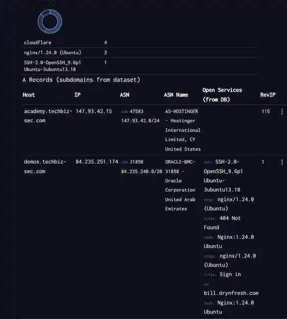

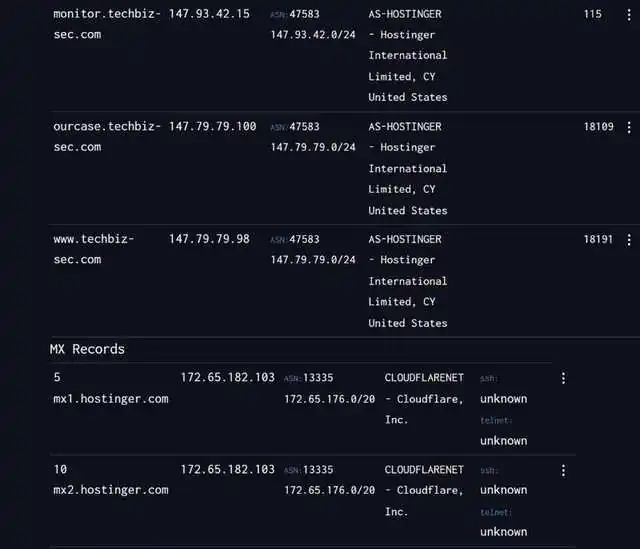

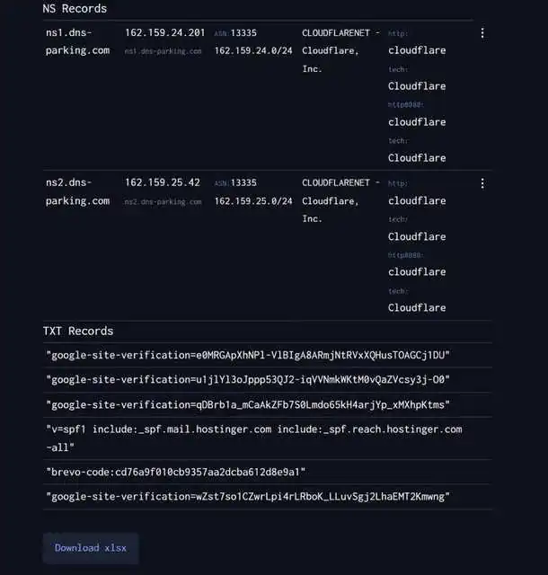

The \`demos\` hostname stood out because the third-party results showed SSH and a sign-in page, and the certificate name did not match the company domain. These service details came from DNSDumpster's database; I did not confirm them with a direct scan. The SPF value ending in \`~all\` is a soft-fail policy, as noted in my report. The \`brevo-code\` TXT record indicated that Brevo was also referenced in the domain's DNS data.

### 7.3 Wayback Machine

I checked the Wayback Machine summary for \`techbiz-sec.com\`. The report recorded **10 saves between November 2, 2024 and October 15, 2025**. The summary showed these file types: HTML (16 captures, 10 unique URLs), PNG (10), SVG (7), MP4 (2), CSS (1) and JPEG (1).

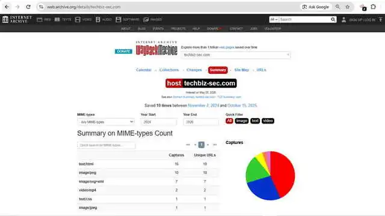

The first archived save was about three weeks after the domain's WHOIS creation date. The archive also retained image and video captures, so older copies of site media may remain available even if the live site later changes.

### 7.4 Shodan

I searched Shodan for \`https://techbiz-sec.com\`. The result captured in the report was **No results found**. This only describes the result of that search term; it does not establish that the domain or its hosts have no exposed services. DNSDumpster returned different information for the \`demos\` hostname.

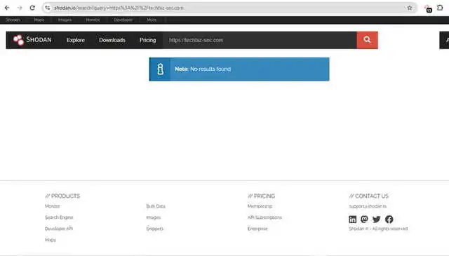

### 7.5 Hunter.io and OSINT Framework

I did not use Hunter.io because it required an account with a professional email address, which I did not have. I consulted OSINT Framework as a directory of tools grouped by information type, including domains, emails, usernames and images. It did not collect information itself, and the report did not include a screenshot for it.

## 8. TryHackMe rooms

I completed the four compulsory rooms listed for this task.

| Room | Learning recorded in the report |
|---|---|
| Passive Reconnaissance | Difference between passive and active recon; using WHOIS, DNS tools, DNSDumpster, crt.sh and Shodan to collect public information |
| Google Dorking | Crawlers, SEO, \`robots.txt\`, sitemaps and operators such as \`site:\`, \`filetype:\`, \`intitle:\` and \`inurl:\` |
| OhSINT | How metadata and separate pieces of public information can be combined to build a larger picture of a person; the room used public information rather than breaking into systems |
| Shodan.io | Shodan searches devices and services rather than ordinary web pages; IP addresses, ASNs, banners and filters help review internet-connected systems |

### Passive Reconnaissance

The room reinforced how public sources can reveal domain registration details, DNS records, subdomains and services without touching the target. From a defender's perspective, the same methods can be used to review an organisation's public footprint.

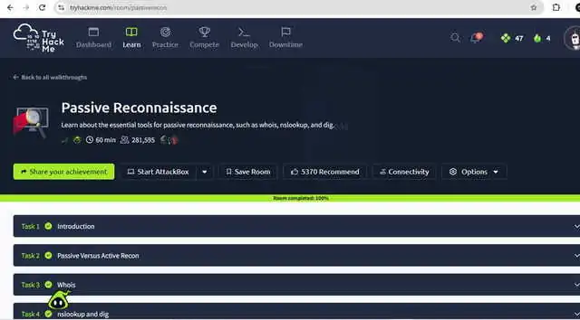

### Google Dorking

The room covered how crawlers discover pages, how SEO affects indexing, and how \`robots.txt\` and sitemaps are used. It also reinforced that \`robots.txt\` is public and is not a security control. Public files and pages can be located quickly with search operators.

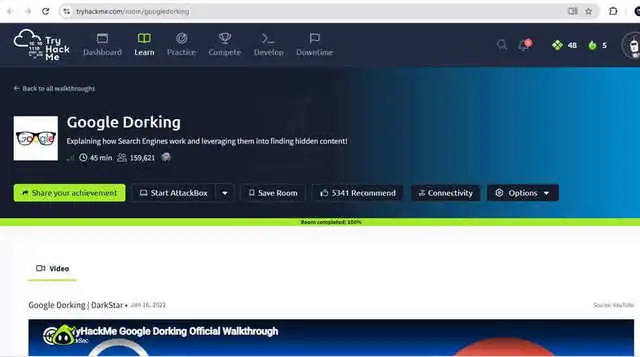

### OhSINT

The room demonstrated how a single image and its metadata can lead to other pieces of public information. The main lesson was that individually small details can become more revealing when they are connected together.

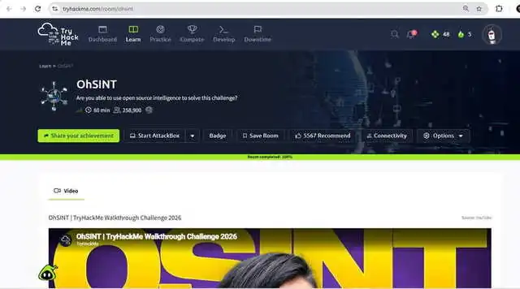

### Shodan.io

The room explained that Shodan is a search engine for internet-connected devices and services. Searching by IP address, ASN, banners and filters can show what services are exposed without conducting a new scan against the target.

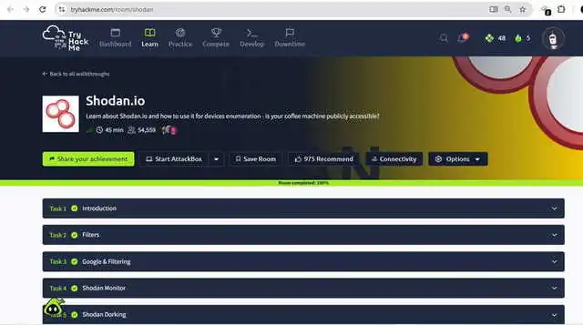

## 9. Summary of findings

| Finding | Source | Significance recorded in the report | Risk level in report |
|---|---|---|---|
| Public contact email, phone and location in Google results | Google \`site:\` search | Could support phishing or social engineering | Low |
| Three course-outline PDFs indexed in \`/outlines\` | Google \`filetype:\` search | Public marketing files; no sensitive content was seen, but metadata can matter | Low |
| Registrant details hidden; only country \`LT\` and a contact-form link shown | WHOIS | Limited personal information visible in the lookup | Low |
| Transfer-prohibited status; registration 2024-10-11 and expiry 2027-10-11 | WHOIS | Domain lock helps reduce transfer risk | Low |
| Five hostnames returned | DNSDumpster | Expands the public footprint; demo and monitoring hosts may need review | Medium |
| \`demos\` reported with SSH, nginx and a sign-in page; certificate name from another domain | DNSDumpster | Service details and certificate-name mismatch are worth checking; results were not directly confirmed | Medium |
| \`ftp.techbiz-sec.com\` found by theHarvester | theHarvester | File-transfer hostname should be checked and protected if it is in use | Medium |
| No emails or people returned by theHarvester | theHarvester | This did not remove the public contact email found through Google | Low |
| Certificates recorded from 2024-10-11 onward | crt.sh | Certificate transparency records can reveal domain names and renewal history | Low |
| Hostinger mail servers, SPF ending \`~all\`, and a Brevo record | DNSDumpster | Indicates mail providers and a soft-fail SPF policy | Low |
| No results for the searched domain | Shodan | Does not prove that nothing is exposed | Low |
| Ten archived saves from November 2024 to October 2025 | Wayback Machine | Historical pages and media may remain accessible | Low |

The risk labels above reproduce the assessment in the report; they are not the result of a separate verification exercise.

## 10. How a defender can reduce the public footprint

The report identified the following defensive actions:

- Enable WHOIS privacy so personal names, phone numbers and email addresses are not unnecessarily public.
- Maintain an inventory of subdomains, remove unused ones and monitor certificate-transparency logs for certificates that were not approved.
- Run equivalent Google searches against the organisation's own domain, remove exposed documents where appropriate, manage indexing and clean document metadata before publishing.
- Avoid publishing staff email addresses in plain text where possible and train staff to recognise phishing.
- Close or protect services that do not need to be exposed to the internet, and review what Shodan shows for the organisation's own assets.
- Use strong login protection, including multi-factor authentication, on login pages.

## 11. Challenges and limitations

Hunter.io was not used because it required a professional email address. Several theHarvester sources required API keys that were not configured, including BuiltWith, Censys, Brave Search, Zoomeye, Fofa and LeakIX. The tool also printed a work-item \`TypeError\`, but still completed and returned data. These limitations mean the results are not a complete inventory of the domain.

The Shodan query returned no results, but that is not proof that there are no exposed services. Likewise, the DNSDumpster service details were taken from its database rather than a direct scan, and the Google \`inurl:login\` query only reported that no matching page was indexed.

## 12. Conclusion

I performed passive reconnaissance on \`techbiz-sec.com\` using WHOIS, Google dorks, theHarvester, crt.sh, DNSDumpster, the Wayback Machine and Shodan. I also completed the four TryHackMe rooms: Passive Reconnaissance, Google Dorking, OhSINT and Shodan.io. Hunter.io could not be used because of its account requirement, and OSINT Framework was consulted as a tool directory.

The combined results showed domain-registration details, public contact information, indexed course-outline PDFs, certificate history, DNS and mail records, archived website captures and several hostnames. TheHarvester and DNSDumpster returned different hostnames and IP information, which reinforced the value of comparing multiple sources. The information gathered points to areas a defender could review, including the \`demos\` host, the \`ftp\` hostname, the SPF soft-fail setting and public contact details. I did not test or confirm a vulnerability in this task. The work remained passive; active scanning would require written permission first.
