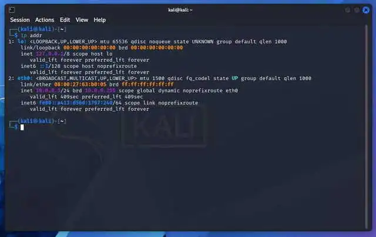
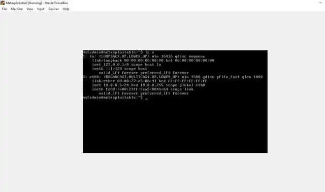
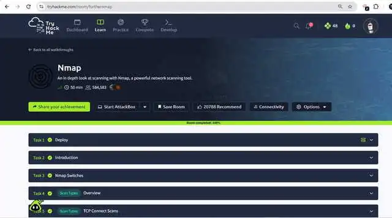
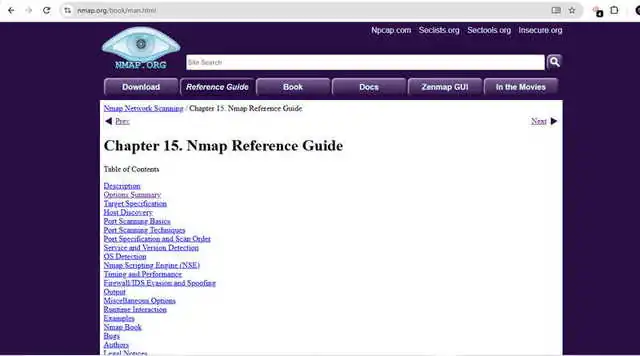
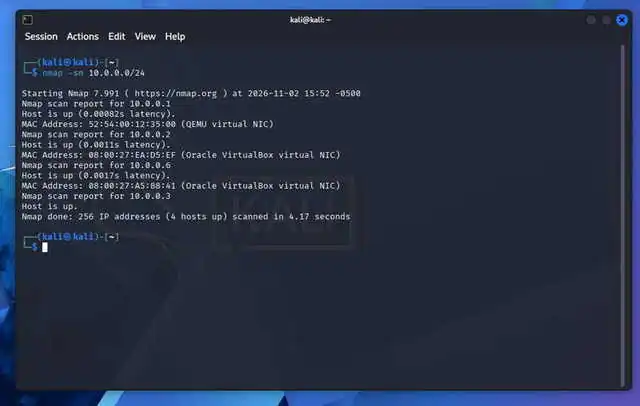
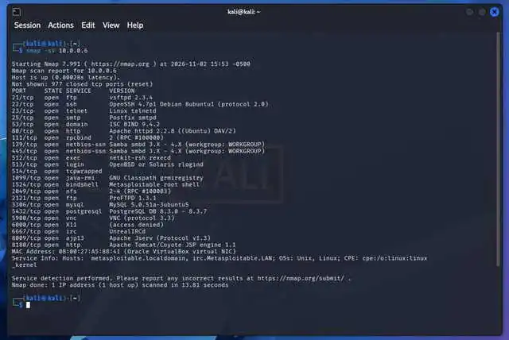
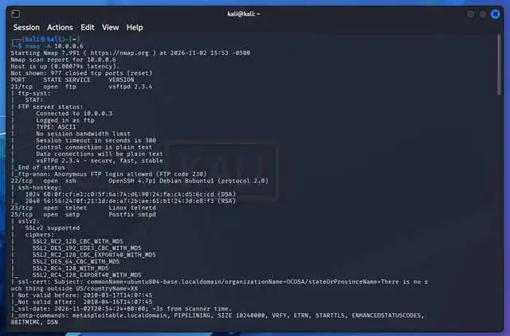
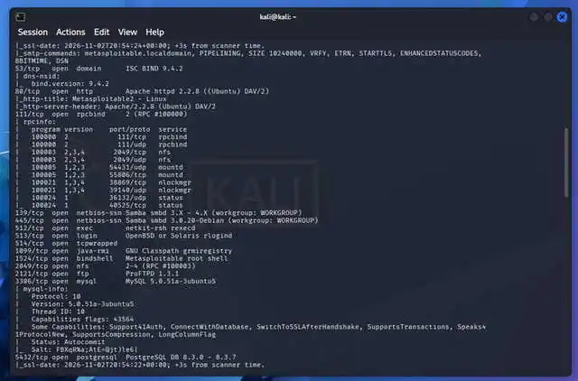
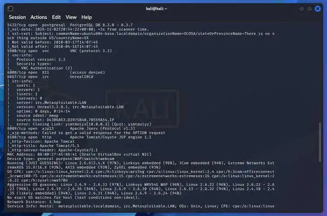
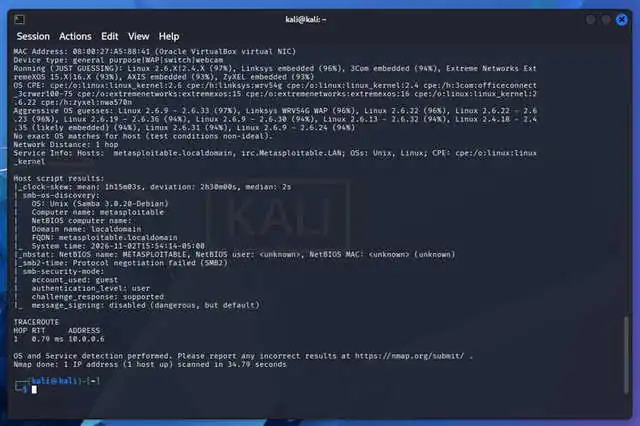

# Week 3, Task 2 — Network Scanning with Nmap

  
  
  

**Internship:** Ethical Hacking Internship, TechBiz Academy  
**Author:** Collins Okike  
**Target:** Metasploitable 2 (\`10.0.0.6\`)

## 1. Objective

In this task I used Nmap to perform active scanning in my own lab. The objectives were to discover live hosts on the network, identify open ports on the target and determine the services and versions running on those ports. I scanned the Metasploitable 2 virtual machine from Kali Linux.

## 2. Lab setup

Both machines were VirtualBox virtual machines on the same network. The detailed scans were limited to my own intentionally vulnerable Metasploitable 2 lab target.

| Machine | Recorded address | Role |
|---|---|---|
| Kali Linux | \`10.0.0.3/24\` | Scanning machine |
| Metasploitable 2 | \`10.0.0.6/24\` | Lab target |
| Network | \`10.0.0.0/24\` | Shared lab network |

I checked the addresses with \`ip addr\` on Kali and \`ip a\` on Metasploitable 2. Both addresses were in the same \`/24\` network.

## 3. Nmap scan types reviewed

I used the TryHackMe Nmap room and the official Nmap Reference Guide to review the scan types used in this task.

| Option | Purpose in this task |
|---|---|
| \`-sn\` | Ping scan for host discovery. It checks which hosts are up without performing a port scan. |
| \`-sV\` | Service/version detection on open ports. |
| \`-A\` | Enables OS detection (\`-O\`), version detection (\`-sV\`), default scripts (\`-sC\`) and traceroute. It returns more detail but is noisier. |

The TryHackMe room also covered TCP Connect, SYN, UDP, NULL, FIN, Xmas and Ping Sweep scans, how Nmap classifies open, closed and filtered ports, and the trade-offs between scan speed, stealth and accuracy.

## 4. Step 1 — Host discovery

I ran a ping scan against the full \`/24\` network:

\`\`\`bash
nmap -sn 10.0.0.0/24
\`\`\`

**My result:** Nmap checked 256 IP addresses and found four hosts up:

| IP address | Identification recorded in the report |
|---|---|
| \`10.0.0.1\` | QEMU virtual NIC shown in the MAC information |
| \`10.0.0.2\` | Oracle VirtualBox virtual NIC shown in the MAC information |
| \`10.0.0.3\` | My Kali Linux machine |
| \`10.0.0.6\` | My Metasploitable 2 target |

The target MAC address was \`08:00:27:A5:88:41\`. The scan completed in **4.17 seconds**. I used \`10.0.0.6\` as the target for the next scans.

## 5. Step 2 — Port scan and service version detection

After identifying the target address, I ran:

\`\`\`bash
nmap -sV 10.0.0.6
\`\`\`

**My result:** The scan reported **23 open ports** and **977 closed ports** and took **13.81 seconds**. The open services included FTP, SSH, Telnet, web servers, MySQL and PostgreSQL. Port 1524 was identified as a Metasploitable root shell. The service-version results also showed \`vsftpd 2.3.4\` on port 21 and UnrealIRCd on port 6667.

## 6. Step 3 — Aggressive scan

I then ran:

\`\`\`bash
nmap -A 10.0.0.6
\`\`\`

The aggressive scan added OS detection, default script results and traceroute information to the service/version results. The additional information recorded in my report included:

- The FTP script reported that anonymous FTP login was allowed (FTP code 230).
- SSLv2 was reported as supported.
- The SMB scripts identified Samba \`3.0.20-Debian\` on port 445 and reported that SMB message signing was disabled.
- The best aggressive OS guess was Linux \`2.6.9 - 2.6.33\` at 97%; the report notes that this remained a guess, not an exact match.
- The traceroute showed one hop to \`10.0.0.6\`, with a recorded RTT of \`0.79 ms\`.
- The aggressive scan took **34.79 seconds**, compared with **13.81 seconds** for \`-sV\`.

### Reading the additional output

| Output section | Interpretation recorded in the report |
|---|---|
| \`Host is up\` and latency | The target answered with less than 1 ms latency on the local lab network. |
| \`Not shown: 977 closed tcp ports\` | Nmap's scan reported 977 closed ports among the scanned top 1,000 TCP ports; 23 open ports were listed. |
| \`PORT / STATE / SERVICE / VERSION\` | The main table of port numbers, states, service names and detected versions. |
| \`ftp-syst\`, \`ftp-anon\` | FTP server information, including anonymous login being allowed. |
| \`ssh-hostkey\` | SSH host keys (DSA and RSA) returned by the service. |
| \`sslv2\`, \`ssl-cert\` | SSLv2 support and certificate information; the report notes the certificate validity ended in 2010. |
| \`rpcinfo\`, \`mysql-info\`, \`vnc-info\`, \`irc-info\` | Additional information about RPC/NFS, MySQL, VNC and UnrealIRCd. |
| \`MAC Address\` | Target MAC \`08:00:27:A5:88:41\`, identified as an Oracle VirtualBox virtual NIC. |
| OS detection / aggressive guesses | OS guesses with percentages; the best reported match was Linux 2.6.9–2.6.33 at 97%, not an exact match. |
| \`Network Distance\` / \`TRACEROUTE\` | The target was one hop away, with the recorded hop RTT of 0.79 ms. |
| \`Host script results\` | Included clock-skew, SMB OS discovery and SMB security-mode results; SMB message signing was disabled. |
| \`Nmap done\` | Total scan time of 34.79 seconds. |

### Normal service scan compared with the aggressive scan

The \`-sV\` scan gave me the main list of open ports, services and versions in 13.81 seconds. The \`-A\` scan added OS detection, default scripts and traceroute. It revealed additional details such as anonymous FTP login, SSLv2 support and disabled SMB message signing, but took 34.79 seconds and generated more traffic. In my report, I noted that the more detailed scan is useful when permitted and when more information is needed, while the less intensive scan is quicker and quieter.

## 7. Open ports and services

The following table reproduces the 23 open ports from my \`-sV\` scan, with the additional notes recorded from the \`-A\` scan.

| Port | State | Service | Version / identification | Note from the report |
|---:|---|---|---|---|
| \`21/tcp\` | open | FTP | vsftpd 2.3.4 | File transfer; anonymous login allowed according to \`-A\` |
| \`22/tcp\` | open | SSH | OpenSSH 4.7p1 Debian 8ubuntu1 | Remote login; very old version |
| \`23/tcp\` | open | Telnet | Linux telnetd | Remote login without encryption |
| \`25/tcp\` | open | SMTP | Postfix smtpd | Mail server |
| \`53/tcp\` | open | domain | ISC BIND 9.4.2 | DNS server |
| \`80/tcp\` | open | HTTP | Apache httpd 2.2.8 (Ubuntu, DAV/2) | Web server; page title \`Metasploitable2 - Linux\` |
| \`111/tcp\` | open | rpcbind | 2 (RPC #100000) | RPC service mapper |
| \`139/tcp\` | open | netbios-ssn | Samba smbd 3.X–4.X | Windows file-sharing service |
| \`445/tcp\` | open | netbios-ssn | Samba smbd 3.X–4.X; \`-A\` showed 3.0.20-Debian | SMB; message signing reported disabled |
| \`512/tcp\` | open | exec | netkit-rsh rexecd | Old remote execution service |
| \`513/tcp\` | open | login | OpenBSD or Solaris rlogind | Old remote login service |
| \`514/tcp\` | open | tcpwrapped | — | Protected by TCP wrappers |
| \`1099/tcp\` | open | java-rmi | GNU Classpath grmiregistry | Java RMI registry |
| \`1524/tcp\` | open | bindshell | Metasploitable root shell | Open root shell; very dangerous |
| \`2049/tcp\` | open | NFS | 2–4 (RPC #100003) | Network file sharing |
| \`2121/tcp\` | open | FTP | ProFTPD 1.3.1 | Second FTP server |
| \`3306/tcp\` | open | MySQL | MySQL 5.0.51a-3ubuntu5 | Database server |
| \`5432/tcp\` | open | PostgreSQL | PostgreSQL DB 8.3.0–8.3.7 | Database server |
| \`5900/tcp\` | open | VNC | VNC protocol 3.3 | Remote desktop |
| \`6000/tcp\` | open | X11 | Access denied | X Window System |
| \`6667/tcp\` | open | IRC | UnrealIRCd; \`-A\` showed Unreal3.2.8.1 | Chat server |
| \`8009/tcp\` | open | ajp13 | Apache JServ Protocol v1.3 | Connector for Tomcat |
| \`8180/tcp\` | open | HTTP | Apache Tomcat/Coyote JSP engine 1.1 (Tomcat 5.5) | Tomcat web server |

## 8. Conclusion

In this task I used \`nmap -sn\` to identify four live hosts on \`10.0.0.0/24\`, \`nmap -sV\` to identify 23 open ports and their service versions on Metasploitable 2 (\`10.0.0.6\`), and \`nmap -A\` to gather additional OS, script and traceroute information. I compiled the open-port list and compared the level of detail and time required by the normal service scan and the aggressive scan.

The task showed me how network scanning maps a target's exposed services and provides information for later enumeration and vulnerability assessment. The scans were performed against my own lab target. In a real assessment, I would only scan systems for which I had permission.
