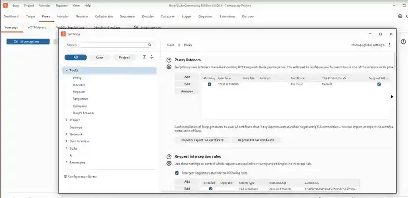
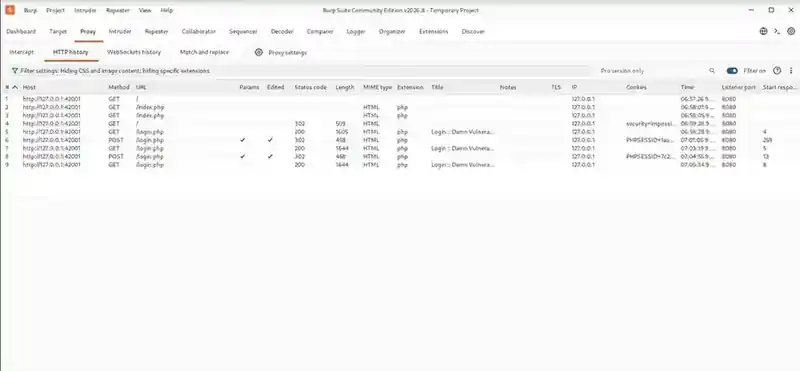

# Week 4, Task 2 — How the Web Works + Burp Suite Intro

  
  
  

**Internship:** Ethical Hacking Internship, TechBiz Academy  
**Author:** Collins Okike  
**Tool:** Burp Suite Community Edition on Kali Linux  
**Lab:** Local DVWA at http://127.0.0.1:42001  
**Proxy listener:** 127.0.0.1:8080

## 1. Introduction

In this task I learned how a browser and a web server communicate over HTTP, then used Burp Suite to intercept a request to DVWA, modify it and forward it. The aim was to understand the traffic that sits underneath normal browser activity and why web application testers inspect the requests sent by a client.

I also completed the TryHackMe rooms Walking An Application and Burp Suite: The Basics.

## 2. How an HTTP request works

An HTTP request is sent by a browser to ask a server for a resource or to submit data. The request contains a request line (method, path and HTTP version), headers such as Host, User-Agent, Cookie and Content-Type, a blank line separating the headers from the request body, and a body that commonly appears in POST requests.

The report recorded this shortened request from the DVWA login page:

~~~http
POST /login.php HTTP/1.1
Host: 127.0.0.1:42001
Content-Length: 88
Content-Type: application/x-www-form-urlencoded
Origin: http://127.0.0.1:42001
Referer: http://127.0.0.1:42001/login.php
Cookie: security=impossible; PHPSESSID=[REDACTED]

username=admin&password=password&Login=Login&user_token=[REDACTED]
~~~

The session identifier and anti-CSRF token are intentionally masked in this public write-up.

## 3. How an HTTP response works

A response contains a status line, headers and a body. The status line includes the HTTP version, a three-digit status code and a short message. The report used this simplified example of the 302 redirect returned by DVWA after a login attempt:

~~~http
HTTP/1.1 302 Found
Server: Apache/2.4.x (Debian)
Set-Cookie: PHPSESSID=[REDACTED]; path=/
Location: index.php
Content-Length: 0
~~~

Response headers can reveal information about server software and configuration. Cookie attributes such as HttpOnly and Secure are also important when reviewing how a web application protects sessions.

## 4. HTTP vs HTTPS

HTTP sends data without transport encryption. HTTPS carries HTTP inside a TLS-encrypted connection. The request and response have the same general structure, but HTTPS encrypts the traffic while it travels between the browser and server. When Burp intercepts HTTPS traffic, the browser must trust Burp's CA certificate; otherwise it will show certificate warnings. DVWA in this lab used plain HTTP, so that certificate step was not needed for this task.

## 5. HTTP methods — GET and POST

The request method tells the server what operation the client is requesting.

| Feature | GET | POST |
|---|---|---|
| Purpose | Ask for data from the server | Send data to the server |
| Where data goes | URL query string | Request body |
| Visible in URL / browser history | Yes | No, not normally in the URL |
| Bookmarkable | Yes | No, not normally |
| Typical use | Page loading and search | Login forms and uploads |
| Suitable for passwords | No | Better than GET, but HTTPS is still required |

Other HTTP methods include PUT, DELETE, HEAD and OPTIONS.

### 5.1 GET example — DVWA SQL Injection page

Before this test I changed the DVWA security level from impossible to low. When I submitted User ID 1 on the SQL Injection page, the value appeared in the URL and request line:

~~~http
GET /vulnerabilities/sqli/?id=1&Submit=Submit HTTP/1.1
~~~

### 5.2 POST example — DVWA login page

The login page used POST. The username and password were placed in the request body rather than the URL. The report observed that GET placed id=1 in the URL, while the login POST carried its submitted fields in the request body. POST keeps those fields out of the URL, but it does not encrypt them; HTTPS is still necessary.

## 6. HTTP status codes

Status codes are three-digit numbers that describe how the request was handled.

| Code | Meaning | Example noted in the report |
|---|---|---|
| 200 OK | Request succeeded | Normal page loading |
| 301 / 302 | Redirect | DVWA redirected after login attempts with 302 |
| 400 Bad Request | Server could not understand the request | A request may be malformed while editing it in Burp |
| 401 Unauthorized | Authentication is required | A page that requires login |
| 403 Forbidden | Access is not allowed | A restricted folder or resource |
| 404 Not Found | Requested path does not exist | A wrong path; also a response considered during directory discovery |
| 500 Internal Server Error | Server-side error | Input that causes the application to fail |

The first digit groups the response: 2xx indicates success, 3xx redirection, 4xx client errors and 5xx server errors. The report also notes that the difference between 403 and 404 can provide clues about whether a resource exists but is restricted.

## 7. Cookies and sessions

HTTP is stateless: each request is separate. To maintain a login, the server creates a session and sends the browser a session ID in a cookie. The browser sends the cookie back in later requests so the server can associate the request with the session.

In DVWA, the session cookie is named PHPSESSID. A separate security cookie stores the DVWA difficulty setting (low, medium, high or impossible). If a session cookie is stolen, another party may be able to act as that user without knowing the password. The report therefore highlights the importance of cookie attributes such as HttpOnly, Secure and SameSite.

The captured login request showed security=impossible and a PHP session cookie. The session value is redacted from the public copy of this report and the evidence images.

## 8. Setting up Burp Suite

I used Burp Suite Community Edition on Kali Linux. The steps recorded were:

1. Open Burp Suite and choose a Temporary project with the default settings.
2. Open Settings → Tools → Proxy and confirm the proxy listener is running on 127.0.0.1:8080.
3. Open Burp's built-in browser, which already sends its traffic through the proxy.
4. Turn Intercept on in the Proxy tab.
5. Open the local DVWA login page at http://127.0.0.1:42001/login.php.

## 9. Intercepting and modifying a DVWA request

With Intercept enabled, I opened the DVWA login page, entered the lab login details and submitted the form. The browser remained waiting because Burp had paused the request before it reached the server.

### 9.1 Intercept the request

The request appeared under Proxy → Intercept as POST /login.php. I could inspect its headers, cookie values and body fields. The body also contained a user_token value used by DVWA as an anti-CSRF token.

### 9.2 Modify the request

Before forwarding the request, I changed the password value in the body from password to password123. This was a test value, not the correct DVWA password.

~~~text
Before: username=admin&password=password&Login=Login...
After:  username=admin&password=password123&Login=Login...
~~~

### 9.3 Forward and inspect the response

I clicked Forward and then turned Intercept off so later requests would not remain paused. The server did not log me in with the changed password. DVWA returned to the login page and displayed Login failed. This demonstrated that the server processes the request Burp forwards, not simply the values originally entered in the browser. It also reinforced why security checks must be performed on the server rather than only in client-side code.

### 9.4 Review HTTP history

I opened Proxy → HTTP history to review the requests and responses. The report recorded two POST /login.php requests (rows 6 and 8), both marked as edited and returning status 302. Each was followed by a GET /login.php response with status 200, showing the login page loading again. The history also showed the earlier GET / and GET /index.php requests.

## 10. TryHackMe rooms

### 10.1 Walking An Application

In this room I learned to review a web application manually using browser developer tools. I used the page source, Inspector, Debugger, Network and Storage tabs to understand what a page displays, how its JavaScript behaves, what requests it makes and what data the browser stores. The room reinforced that manual review can reveal details that automated scanners or scripts may miss.

### 10.2 Burp Suite: The Basics

This room introduced Burp Suite Community Edition, its Dashboard and navigation, the Proxy, browser configuration through FoxyProxy, the site map, issue definitions, scoping and targeting, HTTPS proxying and a short example attack. The main lesson was that Burp sits between a browser and a web application, allowing the tester to intercept and inspect requests and responses.

## 11. Why this matters for security

- Anything the browser sends can be modified by the user, so server-side validation and authorisation are essential.
- Session cookies act like temporary credentials; if they are stolen or predictable, an attacker may take over the session.
- Burp makes the application's request/response behaviour visible, which is a foundation for testing SQL injection, XSS and authentication weaknesses.
- Passwords should not be sent in GET parameters or over plain HTTP. POST over HTTPS is the minimum expectation for a login form.

## 12. Problems faced

Two small issues came up during the exercise:

- After forwarding the login request, Burp intercepted additional requests from the browser. I clicked Forward again until the page loaded.
- I initially left Intercept switched on, which paused every new request and made the browser appear stuck. I turned it off when I was finished and only enabled it when I wanted to capture a request.

## 13. Conclusion

In this task I learned how HTTP requests and responses are structured, the difference between GET and POST, the meaning of common status codes, and how cookies maintain a session. I configured Burp Suite as a proxy and used it with DVWA to intercept a login request, change its body and forward it. The exercise showed why the browser is not a trusted part of a web application and why security checks must be enforced by the server.