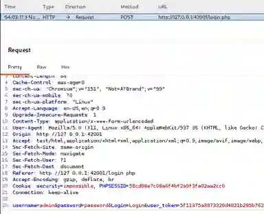
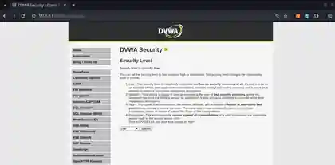
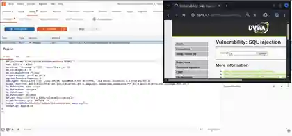
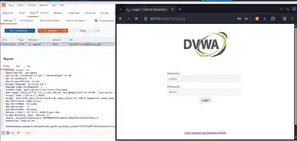
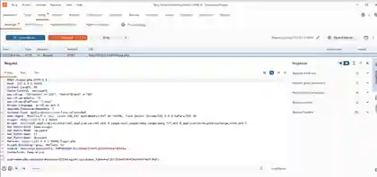
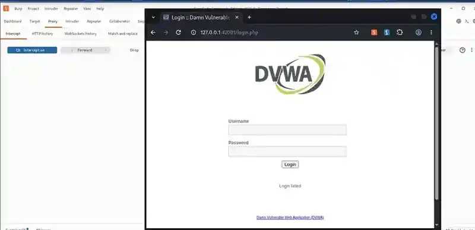
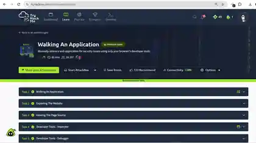
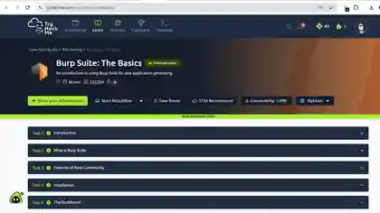

# Week 4, Task 2 — How the Web Works + Burp Suite Intro

  
  
  

**Internship:** Ethical Hacking Internship, TechBiz Academy  
**Author:** Collins Okike  
**Tool:** Burp Suite Community Edition on Kali Linux  
**DVWA:** http://127.0.0.1:42001  
**Proxy listener:** 127.0.0.1:8080

## 1. Introduction

Before this task I used websites without paying much attention to what the browser was sending to the server. I learned the basic parts of HTTP, then used Burp Suite to intercept a request to my local DVWA application, change one of its values and forward it.

This helped me see that a web request is not fixed just because I entered information into a form. A user can inspect and change the request before it reaches the application, so the server has to validate the information itself.

## 2. My lab setup

I used Burp Suite Community Edition in Kali Linux and opened DVWA in Burp's built-in browser.

| Item | Value |
|---|---|
| Operating system | Kali Linux |
| Proxy | Burp Suite Community Edition |
| Proxy listener | 127.0.0.1:8080 |
| DVWA login page | http://127.0.0.1:42001/login.php |
| DVWA SQL Injection page | /vulnerabilities/sqli/ |

I opened Burp, selected a temporary project with the default settings, and checked that the proxy listener was running on 127.0.0.1:8080. I then used Burp's built-in browser, which already sends traffic through the proxy.

## 3. Understanding the HTTP traffic

An HTTP request is what the browser sends to the server. The request I inspected in Burp had these parts:

- **Request line:** method, requested path and HTTP version.
- **Headers:** details such as Host, User-Agent, Cookie and Content-Type.
- **Blank line:** separates the headers from the request body.
- **Body:** form data sent to the application, commonly with POST requests.

The login request used POST /login.php. I could see the submitted username and password in the body, while the Cookie header carried the DVWA security setting and a session identifier. I have removed the session identifier and anti-CSRF token from the example below.

~~~http
POST /login.php HTTP/1.1
Host: 127.0.0.1:42001
Content-Type: application/x-www-form-urlencoded
Cookie: security=impossible; PHPSESSID=[REDACTED]

username=admin&password=password&Login=Login&user_token=[REDACTED]
~~~

The server replies with a response containing a status line, headers and a body. In the report's simplified example, DVWA returned HTTP/1.1 302 Found with a Location header after a login attempt.

## 4. GET, POST and the DVWA examples

I compared a GET request from the SQL Injection page with the POST request from the login page.

Before using the SQL Injection page, I changed DVWA's security level from impossible to low.

| Method | What I saw in DVWA |
|---|---|
| GET | The SQL Injection page put id=1 in the URL: /vulnerabilities/sqli/?id=1&Submit=Submit. |
| POST | The login form sent the username and password in the request body instead of putting them in the URL. |

The GET request had no body. The POST request carried the submitted form fields in its body. POST keeps the values out of the URL and normal browser history, but it does not encrypt them. HTTPS is still needed to protect traffic while it travels between the browser and server.

## 5. Status codes, cookies and sessions

I reviewed the response status codes that appeared during the exercise.

| Code | Meaning | How it relates to my test |
|---|---|---|
| 200 OK | The request succeeded. | The DVWA login page loaded again. |
| 302 Found | The server redirected the browser. | DVWA redirected after the login attempts. |
| 400 Bad Request | The server could not understand the request. | Could occur if a request is malformed during editing. |
| 401 Unauthorized | Authentication is required. | Can appear on pages that require a login. |
| 403 Forbidden | Access is not allowed. | Can indicate a restricted resource. |
| 404 Not Found | The requested path was not found. | Can appear when a path is incorrect. |
| 500 Internal Server Error | The server encountered an error. | Can happen when input causes an application-side problem. |

HTTP does not remember a user between separate requests by itself. DVWA uses the PHPSESSID cookie to associate later requests with the same session. It also uses a security cookie to store the selected DVWA difficulty level. This is why a session cookie needs protection: someone who steals it may be able to act as the logged-in user.

## 6. Intercepting the DVWA login request

With Intercept switched on, I opened the DVWA login page, entered the lab details and submitted the form. The browser appeared to keep loading because Burp had paused the request before it reached DVWA.

I found the request under **Proxy → Intercept**. It was a POST /login.php request. I could inspect the headers, cookies and body before forwarding it.

### Changing the request

I changed the password value in the request body from password to password123.

~~~text
Before: username=admin&password=password&Login=Login...
After:  username=admin&password=password123&Login=Login...
~~~

I then clicked **Forward** to send the modified request to DVWA.

### My result

The login did not succeed. DVWA returned to the login page and displayed **Login failed**. This showed me that the server processed the request Burp forwarded, not just the values I originally typed into the browser.

## 7. Checking the HTTP history

After forwarding the request, I opened **Proxy → HTTP history** to review the requests and responses.

**My result:** The history showed two POST /login.php requests in rows 6 and 8. Burp marked both as edited, and both returned status 302. Each was followed by a GET /login.php request with status 200, which was the login page loading again. I could also see the earlier requests to / and /index.php.

This was useful because I could review requests even after I had turned Intercept off. It also helped me connect the response codes to what I saw in the browser.

## 8. TryHackMe rooms

I completed two rooms for this task.

### Walking An Application

This room showed me how to review a web application manually using browser developer tools. I practised checking page source, inspecting and changing page elements, following JavaScript in the Debugger, reviewing requests in the Network tab and checking data stored by the browser.

The main thing I took from this room was that manual inspection can reveal details that an automated scan may not explain, such as page behaviour, requests and data stored in the browser.

### Burp Suite: The Basics

This room introduced Burp Suite Community Edition, its Dashboard and navigation, the Proxy, browser configuration with FoxyProxy, the site map, issue definitions and scoping. It also covered HTTPS proxying and a short example attack.

The part that connected most with my practical work was the Proxy: Burp sits between the browser and the application, which lets me inspect and change requests and responses.

## 9. What I learned and conclusion

This task helped me understand the traffic behind a normal web page. I can now identify the request line, headers and body, explain the difference between GET and POST, and recognise the status codes that appeared in my DVWA test.

The practical part was intercepting the login request, changing the password value and seeing the server reject it. It made the importance of server-side validation clear: anything the browser sends can be modified before it reaches the application.

I also learned that session cookies should be protected because they can act like temporary credentials. I will use these basics when I continue testing web application weaknesses in later labs.