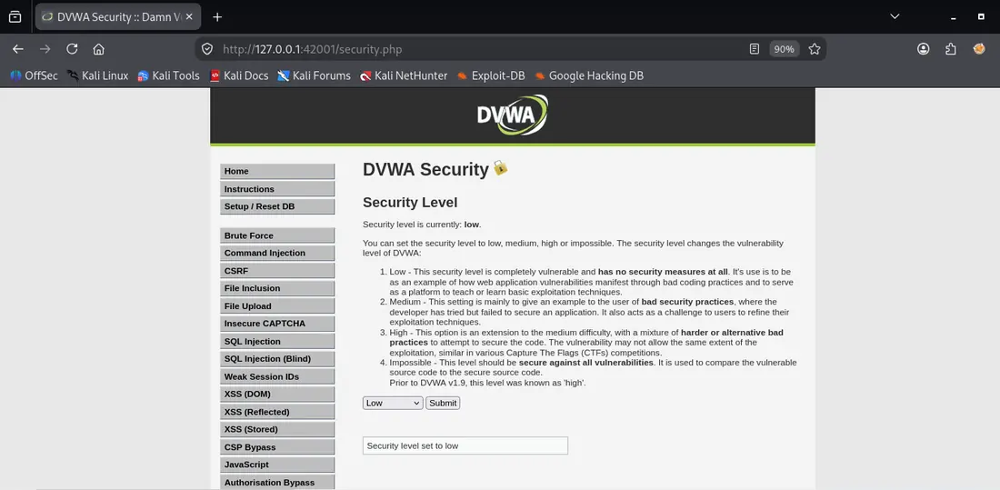
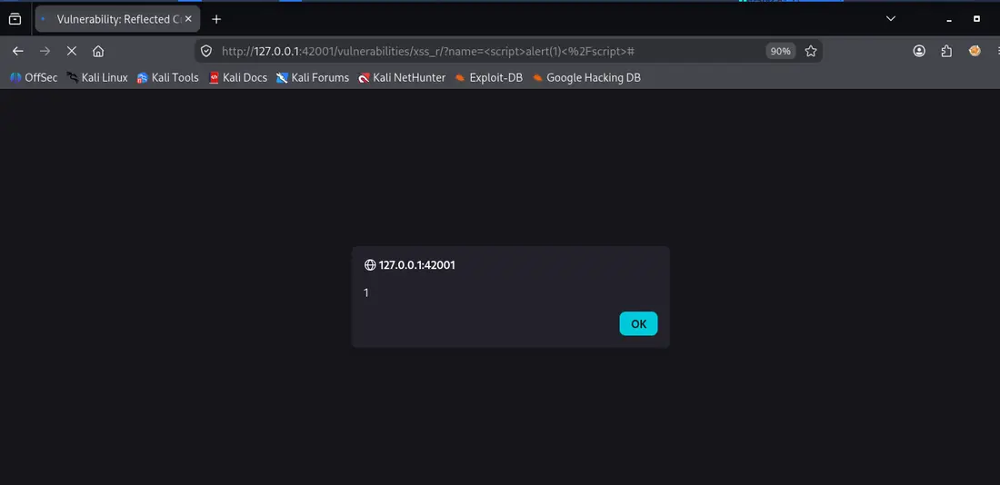
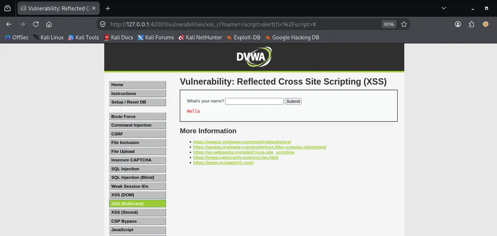
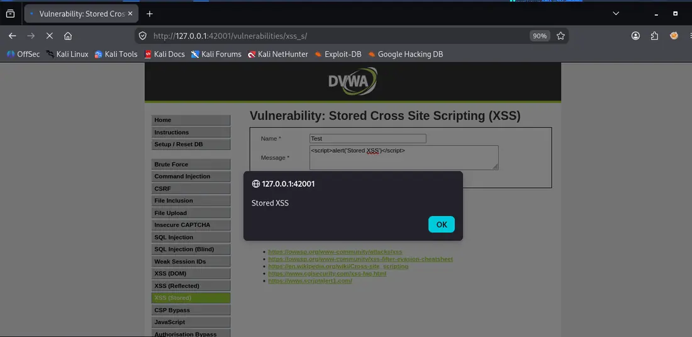
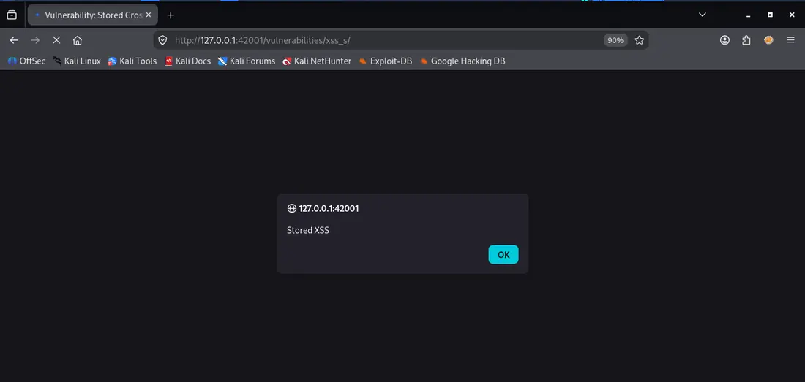
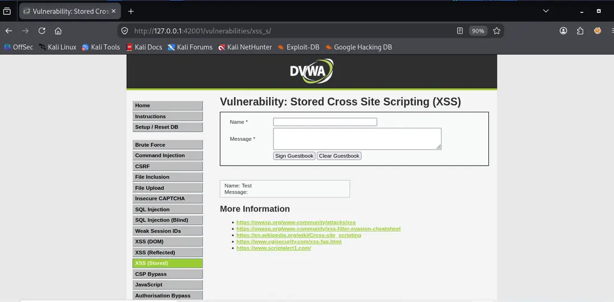
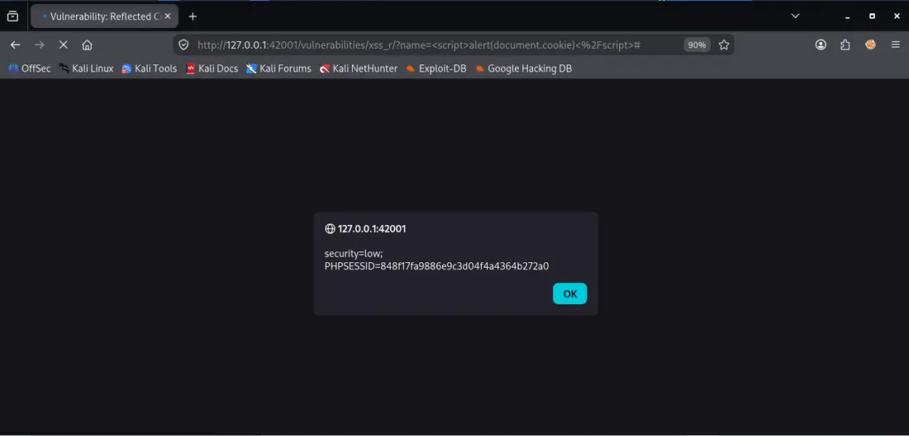
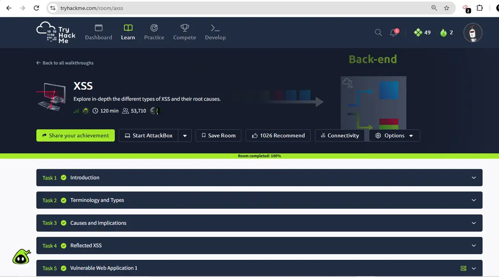
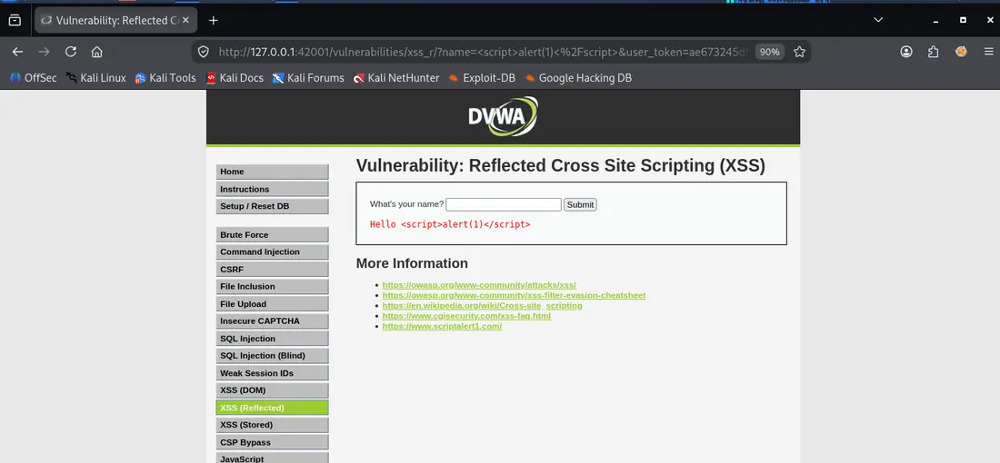

# Week 5, Task 2 — Cross-Site Scripting (XSS)

<p align="center">
  
  
  
</p>

**Internship:** Ethical Hacking Internship, TechBiz Academy  
**Author:** Collins Okike  
**Target:** Damn Vulnerable Web Application (DVWA), Low security

## 1. Introduction

For this task, I opened the XSS sections in DVWA and tried both Reflected XSS and Stored XSS. I started with a simple alert payload, then added a script to the guestbook and checked whether it would still run after I refreshed the page. I also tried reading the cookies from the page and later changed DVWA to Impossible security to compare the result.

From the exercise, I understood that XSS can happen when an application displays user input without handling it safely. The browser may treat that input as HTML or JavaScript and run it. I also read about DOM-based XSS and how it can happen when JavaScript on the page uses untrusted data in an unsafe way.

## 2. Objectives

- Understand what XSS is and why unencoded output is dangerous.
- Set DVWA to Low security and open the Reflected and Stored XSS modules.
- Test a basic script payload and observe the browser's response.
- Submit a guestbook payload and confirm it still runs after reloading the page.
- Compare Reflected, Stored and DOM-based XSS.
- Demonstrate the potential impact of JavaScript reading a session cookie.
- Document remediation and verify output encoding at DVWA Impossible security.

## 3. Understanding XSS

### 3.1 How the vulnerable page works

The Reflected XSS page I tested takes the supplied `name` value and places it directly into the response. The simplified example below shows the behaviour:

```php
echo '<pre>Hello ' . $_GET['name'] . '</pre>';
```

If the application does not encode the value before returning it, the browser may interpret an injected script tag as executable HTML and JavaScript rather than plain text.

### 3.2 Types of XSS

| Type | How it works | Example location |
|---|---|---|
| Reflected | The payload is sent in a request and returned in the response. It is not stored by the application. | Search forms, error messages and URL parameters. |
| Stored | The payload is saved by the application and runs when a page displays the saved content. | Comments, guestbooks, forum posts and profile fields. |
| DOM-based | Client-side JavaScript places untrusted data into an unsafe page location. | Code using unsafe sinks such as `innerHTML` or values from `location.hash`. |

### 3.3 Common techniques I reviewed

| Technique | Purpose | Example payload |
|---|---|---|
| Script tag alert | Checks whether injected JavaScript executes. | `<script>alert(1)</script>` |
| Read the cookie | Shows whether JavaScript can read cookies available to the page. | `<script>alert(document.cookie)</script>` |
| Event handler | Runs JavaScript through an HTML event handler. | `` |

## 4. Lab Setup

I started DVWA in my Kali lab, logged in through the browser, set the security level to **Low**, and opened the Reflected and Stored XSS modules.



## 5. Step 1 — Reflected XSS

On the XSS (Reflected) page, I entered the following payload in the name field and submitted the form:

```html
<script>alert(1)</script>
```

I checked whether an alert appeared and looked at the address bar to see whether the value was sent through the URL. The alert showed the number `1`, and the payload appeared in the `name` parameter. After I clicked OK, the page returned without displaying the payload as ordinary text. This showed that the browser had executed the script in the response.





**What I learned:** The input was returned in the response without being encoded. A user who opened a crafted link could trigger the same script in their browser. The payload was not saved by the application, so this test demonstrated reflected rather than stored XSS.

## 6. Step 2 — Stored XSS

Next I opened the Stored XSS guestbook page. I used a short name and put the payload in the Message field:

```text
Name: Test
Message: <script>alert('Stored XSS')</script>
```

After I selected Sign Guestbook, an alert containing `Stored XSS` appeared. I then opened the Stored XSS page again without submitting another entry. The same alert appeared after the reload, which showed that the payload had been saved and was being returned from the guestbook content. I cleared the guestbook after completing the test.







**What I learned:** Unlike the reflected payload, the stored payload remained in the application and ran whenever the affected page was opened. This means other visitors could be affected without opening a specially crafted link.

## 7. Step 3 — Showing the Impact

To check what JavaScript could read in the page, I returned to the Reflected XSS module and used this payload inside my own lab:

```html
<script>alert(document.cookie)</script>
```

The popup displayed two cookies: `security=low` and `PHPSESSID`. The session cookie was readable from JavaScript in this lab configuration. I did not send the cookie anywhere outside the lab.



This demonstrated why session cookies should use the `HttpOnly` attribute. If a session cookie can be read by injected JavaScript, it may be exposed to an attacker and used to impersonate the logged-in user.

## 8. Reflected XSS Compared with Stored XSS

| Detail | Reflected XSS | Stored XSS |
|---|---|---|
| Where the payload lives | In the request or URL; it is not saved. | Stored by the application, for example in a database. |
| Who may be affected | A user who opens the crafted request or link. | Visitors who load the affected page. |
| User action | The victim generally needs to open the crafted link. | The visitor can be affected by loading the page normally. |
| How long it lasts | For the individual request. | Until the stored content is removed or corrected. |
| DVWA example | `name` parameter on XSS (Reflected). | Message field in the guestbook. |
| Usual severity in this exercise | Medium. | Higher, because it can reach more visitors. |

## 9. Security Impact

I noted several possible consequences when injected JavaScript runs in a victim's browser:

- Read accessible session cookies and potentially take over a session.
- Send requests through the victim's authenticated browser session.
- Change page content or display deceptive login forms.
- Redirect a visitor to another website.
- Capture information entered into an affected page.

I also noted that suspicious input such as `<script>`, `onerror=` and encoded script tags may appear in web server or WAF logs. If I were writing this up as a finding, I would include the affected page, the input I tested, what happened and how it could be fixed.

## 10. TryHackMe Practice

I completed the free [XSS room](https://tryhackme.com/room/axss). The room covered Reflected XSS, Stored XSS and DOM-based XSS, and gave me additional practice with the training applications.



## 11. Remediation — Preventing XSS

- Encode output for the context where it is used so untrusted input is displayed as text rather than executed. For PHP, I noted `htmlspecialchars()` as one way to encode special characters.
- Validate and allow-list input where practical, but do not rely on filtering alone.
- Add a Content Security Policy (CSP) as an additional control to restrict which scripts the browser can run.
- Set session cookies with `HttpOnly`, `Secure` and appropriate `SameSite` attributes.
- Use frameworks that escape output automatically and avoid unsafe DOM operations such as assigning untrusted input to `innerHTML`; use `textContent` where appropriate.
- Treat a Web Application Firewall as an additional layer, not a replacement for secure application code.
- Monitor requests for suspicious script tags and event-handler input.

### 11.1 Verification at DVWA Impossible Security

I changed DVWA to **Impossible** and submitted the same reflected payload:

```html
<script>alert(1)</script>
```

No alert appeared. The page displayed `Hello <script>alert(1)</script>` as plain text, showing that the output was encoded rather than executed. I also noticed that DVWA included a `user_token` in the URL at this security level.



## 12. Conclusion

I tested both Reflected and Stored XSS on DVWA. The main difference became clearer when I refreshed the guestbook page and saw the stored payload run again without submitting it a second time. I also checked what cookies the script could read and tested the same payload after changing the security level to Impossible. At that level, the payload appeared as text instead of running. I completed the TryHackMe XSS room as part of the task. Overall, the practical helped me see why applications need to handle user input properly and protect session cookies.
